# globalFitL3Res.C — what it does, how it flows, and the physics behind it

`globalFitL3Res.C` is the last step of the jecsys L3Res chain. It reads the
`ratio/eta00-13` directory of `rootfiles/jecdata<epoch>.root`, prepared by
`reprocess.C` → `softrad3.C` → `globalFitSyst.C` → `globalFitRenormPF.C`,
and performs the **global fit of the absolute residual jet energy scale**:
one 9-parameter detector/physics model is fitted simultaneously to the
FSR-corrected data/MC response ratios of multijet, γ+jet, Z+jet and W→qq'
(pT balance and MPF) and to the data − MC differences of the PF energy
fractions, with 27 nuisance parameters for the systematic uncertainties.
The fit result and its eigenvectors are written back into the file, the
error matrix into a separate file, and eight canvases into `pdf/<epoch>/`.

The worked example is the run

```
root -b -q 'mk_reprocess_RunEpoch.C("2016BCDEF")' > tmp_globalFitL3Res.log 2>&1
```

with everything but the final

```
globalFitL3Res(0.0,1.3, epoch, "MJDJ_gam_z_hadw", "PtBalMPF"); // DP_2021
```

commented out in `mk_reprocess.C`. The log has 436 lines: the list of
sample configurations, 34 `scale...1` lines, the MINUIT printout (36
parameters), the χ² summary, the nuisance-parameter table and the
`SaveAs` messages (§5).

---

## 1. Inputs and outputs

**Inputs**

| what | where | role |
|---|---|---|
| `ratio/eta00-13/{ptchs,mpfchs1}_{multijet,hadw}_a30`, `{ptchs,mpfchs1}_{gamjet,zjet}_a100` | `jecdata2016BCDEF.root` (file `f`) | the response ratios that are fitted (α < 0.30 multijet/hadW, α < 1.00 Z/γ+jet because `useZJet100 = useGJet100 = alsoPtBal100 = true`) |
| `ratio/eta00-13/crecoil_multijet_a30` | `f` | recoil pT fraction, to evaluate the fit at the multijet recoil pT |
| `ratio/eta00-13/fsr/hkfsr3_{ptchs,mpfchs1}_{multijet,gamjet,zjet}` | `f` | additive FSR correction from `softrad3.C` |
| `ratio/eta00-13/fsr/hkfsr3_*_{mpfu1,mpfn1}` | `f` | FSR uncertainty sources (Ru data-only +0.08, Rn data-only −0.01) |
| `ratio/eta00-13/fsr/hadw_fsr` | `f` | hadW FSR factor (loaded but not applied, `dofsrhadw = false`) |
| `ratio/eta00-13/sys/hadw_{ptave,ptboth}_fitprob[2]` | `fsys` = same file (reference IOV = 2016BCDEF) | hadW systematics |
| `ratio/eta00-13/sys/zee_gamjet_eig0..2` | `f` | photon energy scale eigenvectors from the Zee mass fit |
| `ratio/eta00-13/{chf,nhf,nef}_pfjet_a30`, `{chf,nhf,nef}_zjet_a100` | `f` | PF composition data − MC (dijet and Z+jet) |
| `ratio/eta00-13/{hjes,herr,herr_l2l3res,herr_ref,herr_noflv,herr_spr,herr_pu,hrun1,hl1bias,counts_hadw_a30}` | `f` | JES bands for plotting; `herr_l2l3res` is also the closure reference inside the fit function |
| `jet_Run16ULBCDEF_fwd` | `DP2021033V2/drawDeltaJEC_16ULJECV5_vsBCDEF.root` | inclusive-jet response for plotting and as binning template of `hjesfit` (63 bins, 10–5492 GeV) |
| `ratio/eta00-13/mpfchs1_incjet_a30|a100` | `f` | inclusive jets, plotted only (`plotIncJet`) |

**Outputs**

```
rootfiles/jecdata2016BCDEF.root  (UPDATE, since storeJesFit || isRefIOV)
  ratio/eta00-13/sys/emat, vpar, verr          TMatrixD/TVectorD  full 36×36 error matrix, parameters, errors
  ratio/eta00-13/sys/h2emat, h2cov, h1par      TH2D/TH1D          same with labelled axes (p0..p8, bm*_ source names)
  ratio/eta00-13/sys/hjesfit                   TH1D   fit function on the inclusive-jet binning, error = quadrature sum of the 9 eigenvector shifts
  ratio/eta00-13/sys/hjesfit2                  TH1D   hjesfit × herr_l2l3res (absolute, closure undone)
  ratio/eta00-13/sys/hjesfit_eig0..8           TH1D   f(p + e_k sqrt(λ_k)) − f(p)   per eigenvector
  ratio/eta00-13/sys/hjesfit_par0..8           TH1D   contribution of each single parameter (± its error)
  ratio/eta00-13/sys/fjesfit, fjesfit_eig0..8, fjesfit_par0..8   TF1   same as functions
  ratio/eta00-13/sys/eigvec, eigmat            eigenvalues and eigenvectors of the 9×9 matrix
  ratio/eta00-13/fsr/hkfsr2_{ptchs,mpfchs1}_{multijet,gamjet,zjet}         TH1D  post-fit FSR correction  hkfsr3 − Σ a_s σ_s
  ratio/eta00-13/fsr/hkfsr2_{ptchs,mpfchs1}_{multijet,gamjet,zjet}_eig0,1  TH1D  the two FSR sources scaled by their fitted nuisance
rootfiles/globalFitL3Res_emat_2016BCDEF.root   emat, vpar, verr, h2emat, h2cov, h1par (RECREATE)
textFiles/globalFitL3Res.txt                   one appended line: if (set=="2016BCDEF SimpleL1") { p[0] = 3.876, p[1] = -0.433, p[2] = 1.16; }
pdf/2016BCDEF/globalFitL3res_raw.pdf           data before FSR correction
pdf/2016BCDEF/globalFitL3res_orig.pdf          data after FSR correction, before fit
pdf/2016BCDEF/globalFitL3res_shifted.pdf/.root data shifted by fitted nuisances, with fit and ±1σ band
pdf/2016BCDEF/globalFitL3res_doublyshifted.pdf/.root   same multiplied by herr_l2l3res (absolute scale, "DP2021" style)
pdf/2016BCDEF/globalFitL3res_hsrc.pdf          histogram of fitted nuisance parameters
pdf/2016BCDEF/globalFitL3res_ptchs_kfsr.pdf, _mpfchs1_kfsr.pdf   FSR corrections in (hkfsr3) and out (hkfsr2)
pdf/2016BCDEF/globalFitL3res_pfjet.pdf/.root   PF composition data − MC with the fitted model
```

`hjesfit_eig*` is what `globalFitL3Res.C` itself reads for non-reference
IOVs (`useIncJetRefIOVUncert`) and what `globalFitRun2.C` reads; `hkfsr2_*`
is the "output FSR" used when `dofsrcombo2` is on.

---

## 2. Overall flowchart

```mermaid
flowchart TD
    A[globalFitL3Res etamin etamax epoch selectSample selectMethods] --> B[Epoch flags, refIOV<br/>open f, fsys, ffsr READ and fout UPDATE<br/>open inclusive-jet file fij]
    B --> C[methods = ptchs, mpfchs1<br/>samples = multijet, gamjet, zjet, hadw<br/>bit ibm = isample + 4·imethod]
    C --> D[Load PF fractions<br/>chf/nhf/nef zjet_a100 → _vpfz<br/>chf/nhf/nef pfjet_a30 → _vpf<br/>setToyShapeFuncs: response and composition shapes]
    D --> E[Load 8 response graphs<br/>drop y=0 or ey=0 points<br/>clone to original, shifted, raw<br/>crecoil for multijet]
    E --> F[FSR correction<br/>Z, γ, multijet: R → R + hkfsr3<br/>hadW: none<br/>multijet raw/shifted × herr at pT,recoil for plots]
    F --> G[Build 27 nuisance sources hs<br/>16 FSR, 2 scale, 2 hdmscale,<br/>4 hadW fitprob, 3 γ EES eigenvectors<br/>name bm&lt;mask&gt;_… encodes which graphs]
    G --> H[Draw original data c0<br/>Draw raw response c0b]
    H --> I[TFitter 36 parameters, FCN = jesFitter<br/>MIGRAD → emat]
    I --> J[Recompute χ² pieces<br/>print parameters, matrices, sources<br/>store emat to file and sys/]
    J --> K[Draw shifted data c1<br/>eigen-decompose 9×9 → hjesfit, hjesfit_eig<br/>Draw doubly-shifted c1d]
    K --> L[Save raw, orig, shifted, doublyshifted, hsrc]
    L --> M[FSR in/out plots c3 per method<br/>write hkfsr2_* and sys/hjesfit* to file]
    M --> N[PF composition plot c4<br/>close files]
```



Compact text version:

```
globalFitL3Res(0, 1.3, "2016BCDEF", "MJDJ_gam_z_hadw", "PtBalMPF")
 1. flags: isUL16, isAPV, isRefIOV (2016BCDEF is its own reference IOV)
 2. open jecdata2016BCDEF.root ×4 (f, fsys, ffsr read; fout update) and DP2021033V2/drawDeltaJEC_16ULJECV5_vsBCDEF.root
 3. samples {multijet, gamjet, zjet, hadw} × methods {ptchs, mpfchs1} → 8 graphs, bit 1<<ibm
 4. PF fractions: Z+jet a100 and dijet a30, toy-PF shapes (setToyShapeFuncs)
 5. load graphs, clean, FSR-correct with hkfsr3 (additive), keep raw copies
 6. 27 uncertainty sources as TH1D with bitmask names
 7. draw "Before FSR correction" (raw) and "Before global fit" (orig)
 8. MINUIT fit of 9 + 27 parameters, χ² in jesFitter()
 9. print χ² breakdown, parameters, error/correlation matrices, nuisances
10. draw post-fit canvases, eigenvectors → hjesfit, write sys/ and fsr/hkfsr2
11. FSR in/out and PF composition canvases; save; close
```

---

## 3. Stage-by-stage walkthrough (code view)

Line numbers refer to the current `globalFitL3Res.C`.

### 3.1 Global switches that matter for this run (lines 42–154)

| switch | value | effect |
|---|---|---|
| `alpha`, `ptmj` | 0.30, 30 | α tag for hadW (`_a30`) and multijet (`_a30`) |
| `dofsr`, `dofsr3`, `dofsr3zj/gj/mj` | true | FSR from `softrad3.C` (`hkfsr3_*`), applied as `R + hkfsr3` |
| `dofsrhadw` | false (`DP_2021`) | hadW points are *not* FSR-corrected (`kfsr = 1`) |
| `dofsrcombo1/2`, `fixfsrcombo` | false | FSR taken from the epoch's own file and refitted |
| `useZJet100`, `useGJet100`, `alsoPtBal100` | true | Z/γ+jet use the α < 1.00 graphs for both MPF and pT balance |
| `usePF`, `fitPF`, `fitPF_delta`, `minPFpt`, `maxPFpt` | true, true, 0.20 %, 43, 600 GeV | dijet PF fractions in the χ² with a 0.20 % free band |
| `usePFZ`, `fitPFZ`, `fitPFZ_delta`, `minPFZpt`, `maxPFZpt` | true, true, 0.10 %, 25, 300 GeV | Z+jet PF fractions in the χ² with a 0.10 % free band |
| `usePFG`, `usePFC` | false (`DP_2021`) | no γ+jet and no combined PF fractions |
| `useL2L3ResForClosure` + `CorLevel == "L1L2L3Res"` | true | the model is divided by `herr_l2l3res` (closure) |
| `njesFit`, `penalizeFitPars` | 9, 9 | 9-parameter model, unit Gaussian prior on all 9 |
| `useP0Trk … useP8Flv` | all true except `useP2CalX`, `useP8MB80*` | which model components are active (table in §3.2) |
| `ptminJesFit` | 15 GeV | points below are ignored in the χ² |
| `_cleanUncert` | 0.05 | points with error > 5 % are dropped from the *shifted* plot only |
| `storeErrorMatrix`, `storeJesFit`, `writeTextFile` | true | outputs of §1 |
| `useIncJet`, `plotIncJet` | true | inclusive jets loaded and plotted (not fitted; `incjet` is not in the sample list) |
| `shiftPtBal` | 0.975 | pT-balance points drawn at 0.975·pT for visibility |

### 3.2 The fit model `jesFit` (lines 204–351)

For `njesFit == 9` (lines 322–350):

```
f(pT; p) = [ 1 + Σ_k p_k · s_k(pT) ] / jesref(pT),      jesref = herr_l2l3res interpolated
```

| k | label in plot | shape `s_k` | physics |
|---|---|---|---|
| 0 | trk | 0.01·`ftd`(pT) | tracking inefficiency, "−1 %" variation (UL17 data shape, `DP_2021`) |
| 1 | ph | 0.01·`fp` = −0.0083 (flat) | photon energy scale −3 % (toy PF) |
| 2 | hx | 0.01·`fhx`(pT) | hadron HCAL scale, −3 % → +3 % crossover (toy PF, `DP_2021`) |
| 3 | hh | 0.01·`fhh`(pT) | hadron HCAL scale −3 % (SPRH) |
| 4 | he | 0.01·`feh`(pT) | hadron ECAL scale −3 % (SPRE) |
| 5 | hw | 0.3·0.01·`fhw`(pT) | Herwig++ vs Pythia8 CP5 fragmentation, scaled by 0.3 |
| 6 | rc | `fl1`(pT) − 1 | L1RC vs L1Simple offset difference (hl1rcos fit, BCDEF) |
| 7 | td | 0.01·3·(`ftd` − `ftm`)(pT) | tracking data − MC difference |
| 8 | flv | 1 − `f1q3`(pT) | Z+quark vs Z+jet flavour response shape (`Flavor.C`) |

Each `p_k` is thus the multiplier of one unit-sized detector or physics
variation, and the penalty `Σ p_k²` in the χ² (lines 3271–3283) acts as a
unit Gaussian prior on each. The shape functions are set in
`setToyShapeFuncs()` (lines 3359–3500, `DP_2021`; `setFullShapeFuncs()` is
off), together with the **PF composition shapes** `_mpf[var][k]`: for each
of CHF, NHF, NEF and each of p0–p5 a function giving the change of the
fraction (in %) per unit of `p_k`. p6, p7 have no composition shape, p8 only
for the disabled MB80 option.

### 3.3 Sample and method configuration (lines 354–660)

`selectMethods = "PtBalMPF"` → `methods = {ptchs, mpfchs1}`.
`selectSample = "MJDJ_gam_z_hadw"` → `samples = {multijet, gamjet, zjet,
hadw}` (for |η| < 1.3 `multijet`, otherwise `dijet`), `nsample0 = 1`,
`igj = 0`, `izll = 1`, `iwmh = 2`. All 22 available keys are printed at the
start of the log. The index `ibm = isample + nsamples·imethod` numbers the
eight graphs 0–7 and `1<<ibm` is the bit used in source names:

| bit | graph | bit | graph |
|---|---|---|---|
| 1 | ptchs multijet (MJB) | 16 | mpfchs1 multijet |
| 2 | ptchs gamjet | 32 | mpfchs1 gamjet |
| 4 | ptchs zjet | 64 | mpfchs1 zjet |
| 8 | ptchs hadw ("pT,ave") | 128 | mpfchs1 hadw ("pT,both") |

### 3.4 PF fractions (lines 717–866)

`usePFZ`: `chf/nhf/nef_zjet_a100` (because `zjet` is in the sample set;
otherwise `zlljet`, fallback `zmmjet`). `usePF`: `chf/nhf/nef_pfjet_a30`.
Each is stored with a clone (`_vpfz2`, `_vpf2`) that the fitter fills with
the model prediction for plotting.

### 3.5 Loading and correcting the response data (lines 873–1184)

* Graph names: `ptchs_multijet_a30`, `mpfchs1_multijet_a30`,
  `*_gamjet_a100`, `*_zjet_a100`, `*_hadw_a30`. Points with `y == 0` or
  `ey == 0` are removed. Three clones: `_original` (fit input), `_shifted`
  (fit input + nuisance shifts, for plots), `_raw` (no FSR).
* Multijet also loads `crecoil_multijet_a30` twice (MJB and MPF slots).
* FSR (lines 1043–1184). For Z+jet, γ+jet and multijet
  `kfsr = (r + hkfsr3(pT)) / r`, i.e. the point becomes `r + hkfsr3`,
  the HDM-corrected ratio from `softrad3.C`. For hadW `kfsr = 1`
  (`DP_2021`). Printed `scale...1` once per multijet point and method (34
  lines): the legacy L2Res-rescaling branch is entered for multijet but
  with `scalingForL2OrL3Fit = "None"` the scale stays 1.
* Multijet (lines 1151–1166): `_original` keeps the *relative*
  ⟨R_lead⟩/⟨R_recoil⟩ (the fitter handles the recoil), while `_shifted`
  and `_raw` are multiplied by the reference JES `herr` at the recoil pT
  for drawing, and `gf2`/`gf3` get the "downward" points (the recoil
  response implied at pT,recoil).

### 3.6 Uncertainty sources (lines 1187–1615)

Each source is a `TH1D` of response shifts versus pT whose **name**
`bm<mask>_<label>` tells `jesFitter` which graphs it applies to (bitwise
AND of `mask` with `1<<ig`). For this configuration:

| # | name | applies to | content | origin |
|---|---|---|---|---|
| 1–8 | `bm{1,2,4,8,16,32,64,128}_<sample>_fsru1` | one graph each | `hkfsr3_<method>_<sample>_mpfu1`: Ru +0.08 in data only | `softrad3.C` |
| 9–16 | `…_fsrn1` | one graph each | `hkfsr3_…_mpfn1`: Rn −0.01 in data only | `softrad3.C` |
| (4, 8, 12, 16) | `bm8_inactive_hkfsr_ptchs_hadw_eig0/1`, `bm128_…mpfchs1…` | hadW | all zeros (no FSR source for hadW) | placeholders |
| 17 | `bm34_scale_020_gamjet` | γ+jet DB and MPF | flat 0.0020 | photon scale, UL16 value |
| 18 | `bm68_scale_020_zjet` | Z+jet DB and MPF | flat 0.0020 | Z (muon) scale |
| 19 | `bm34_hdmscale_020_mpfchs1_gamjet` | γ+jet DB and MPF | flat 0.0020 | second copy of 17 ("MPF footprint" source, applied to both methods when `dofsr3`) |
| 20 | `bm68_hdmscale_020_mpfchs1_zjet` | Z+jet DB and MPF | flat 0.0020 | second copy of 18 |
| 21–24 | `bm8_hadw_ptave_fitprob`, `bm128_hadw_ptboth_fitprob`, `…fitprob2` | hadW DB, hadW MPF | `sys/hadw_*` | `globalFitSyst.C` |
| 25–27 | `bm34_eesfromzee_gamjet_eig0..2` | γ+jet DB and MPF | `sys/zee_gamjet_eig*` | `globalFitSyst.C` |

Not present here: `sys/jer_multijet` (`nsrcmj = 0`), the pT-balance shape
source (off when `dofsr3`), inclusive-jet eigenvectors (no `incjet` in
the sample set), low-PU pileup source. Total 27, of which 23 are
non-trivial (the four hadW FSR placeholders are zero).

Sources 17/19 and 18/20 have identical masks and magnitudes, so the fit
cannot separate them; they come out with identical values (−0.95 ± 0.54
and 0.29 ± 0.52) and together act as a single 0.28 % scale uncertainty.

### 3.7 The χ² (`jesFitter`, lines 3001–3296)

```
χ² = Σ_graphs Σ_points [ (R_i + Σ_s a_s·σ_s(pT_i) − f(pT_i;p)) / ε_i ]²        response points (107)
   + Σ_PF points  [ max(|Δf_i − Σ_k 0.01·c_k(pT_i)·p_k| − δ, 0) / ε_i ]²      dijet (43–600 GeV) and Z+jet (25–300 GeV) PF fractions (≈105)
   + Σ_s a_s²                                                                  27 nuisances
   + Σ_{k<9} p_k²                                                              9 parameter priors
```

* `R_i` are the FSR-corrected ratios of the `_original` graphs, `σ_s` the
  source histograms, `a_s` the nuisance parameters, `ε_i` the statistical
  errors.
* For multijet, `R_i` and `ε_i` are multiplied by `f(pT_recoil)` with
  `pT_recoil = crecoil(pT)·pT`, because MJB = R(pT,lead)/R(pT,recoil)
  (lines 3035–3043). The fit also fills the "downward" graph `gf2` with
  `f(pT)·f(pT_recoil)/(R + shifts)`.
* `Δf_i` is the data − MC PF fraction difference, `c_k` the composition
  shapes from `_mpf`, `δ` the free band (0.20 % dijet, 0.10 % Z+jet) inside
  which no penalty is paid.
* `Nk` counts response points, PF points and the 9 priors: 221 for this
  run (107 + 105 + 9), so the printed NDF is 221 − 9 = 212.
* Every 100 FCN calls a `.` is printed (32 dots → 3395 calls).

The fit is `TFitter` (MINUIT) with 36 parameters, start values
(1,1,1,1,1,0,0,1,0) for p0–p8 with step 0.01, 0 with step 1 for the
nuisances, limits ±100, one `MINI` call (lines 1981–1996).

### 3.8 After the fit (lines 1998–2616)

* χ² recomputed with the final parameters; per-dataset χ² and the number
  of "sources that count" (|a| > 0.015 or error ≠ 1 within 1.5 %).
* Error matrix to `rootfiles/globalFitL3Res_emat_<epoch>.root` and
  `sys/` (§1).
* Printout: χ² summary, parameters with errors, the `{…}` line for
  `l2l3res.C`, "Constant scale @ HCAL=0" (`f` at the pT where the Run 1
  SPR shape equals 1), 9×9 error, square-root and correlation matrices,
  the nuisance table.
* Shifted plot `c1`: data + Σ a_s σ_s, fit curve, ±1σ band from `fitError`
  (numerical derivatives × `emat`), the nine `p_k` values as text.
* Eigen-decomposition of the 9×9 matrix → `hjesfit` (error = quadrature
  sum of eigenvector shifts), `hjesfit2 = hjesfit × herr_l2l3res`.
* Doubly-shifted plot `c1d` (`DP2021` block, lines 2461–2560): everything
  multiplied by `herr_l2l3res` (`origJES`) so the y-axis is the absolute
  data/MC response, with the V7 band (`herr_dp`) and the fit ±1σ.
* `c3` FSR plots per method (lines 2621–2806): input `hkfsr3` ("In") and
  `hke = hkfsr3 − Σ a_s σ_s` ("Out") with the propagated error; the "Out"
  histograms are written as `fsr/hkfsr2_*` because `isRefIOV`.
* `c4` PF composition plot (lines 2809–2985): input data − MC (points),
  fitted composition change (bands) for dijet and Z+jet in units of 10⁻².

---

## 4. Physics view

### 4.1 What is being fitted

After L1 (pileup), L2Relative/L3Absolute (MC truth) and L2Res (η
intercalibration from dijets) the remaining data/MC difference of the jet
response in the barrel, |η| < 1.3, as a function of pT is the **L3Res**
(absolute residual). It is measured with several reference objects:
Z(→μμ, ee)+jet at 15–700 GeV, γ+jet at 40–1200 GeV, W→qq' from tt̄ at
70–175 GeV, and multijet at 130–2100 GeV (leading jet against the recoil
of ≥ 2 softer jets). Two methods per channel, pT balance ("DB") and MPF,
differ in their sensitivity to FSR/ISR and to the unclustered energy.

Rather than fitting an ad-hoc function, the model in §3.2 expresses the
residual as a sum of *physically motivated* response shapes, each tied to
a detector effect (tracking, ECAL/HCAL hadron scale, photon scale, offset
method) or to physics modelling (fragmentation, flavour). The same effects
also predict changes in the PF energy fractions, so including the data − MC
differences of CHF, NEF and NHF in the χ² constrains *which* effect is
responsible (e.g. a tracking inefficiency lowers CHF, an HCAL scale shift
moves NHF). The unit priors `p_k²` encode the expectation that each
variation is "about one unit" in size.

### 4.2 Nuisance parameters

Systematic uncertainties enter as shifts `a_s σ_s(pT)` of the data with a
unit Gaussian penalty, the standard profile-likelihood treatment:

* **FSR/ISR**: the HDM assumptions on the unclustered (`Ru`) and other-jet
  (`Rn`) response in data (`softrad3.md` §4.2), one source per channel and
  method. Only the *data-only* variations `_mpfu1`, `_mpfn1` are used
  (`neigmax = 2`); the common data+MC variations cancel in the ratio.
* **Lepton/photon scale**: 0.20 % flat for Z+jet and γ+jet (UL16 values,
  consistent with the Z mass fit), applied to both methods.
* **Photon energy scale from the Zee fit**: three eigenvectors of the
  electron-scale fit evaluated at 2·pT,γ (`globalFitSyst.md`).
* **hadW**: dependence on the kinematic-fit probability cut, two
  functional forms, separately for the two observables.

### 4.3 Closure and the two sets of outputs

The inputs were produced with the V7 L2L3Res already applied
(`CorLevel = L1L2L3Res`), so the data/MC ratios are ≈ 1 and the fit is a
*closure test*. The model describes the response before residual
corrections, and dividing it by `herr_l2l3res` maps it onto the closure
level. Consequently

* `hjesfit` ≈ 1 is the closure-level fit (0.999 at 100 GeV, 1.026 at
  15–18 GeV, 1.000 at 1 TeV), and
* `hjesfit2 = hjesfit × herr_l2l3res` is the new absolute data/MC
  response the next L3Res would correct (0.974 at 50 GeV rising to 1.00 at
  3 TeV).

The "doubly-shifted" canvas shows the second view, with the V7 band for
comparison.

### 4.4 Multijet as a relative measurement

Multijet balancing measures R(pT,lead)/R(pT,recoil) with the recoil at
about 0.40–0.46 × pT,lead. In the χ² the model is therefore evaluated at
both pT values (`data × f(pT_recoil)` vs `f(pT_lead)`), which lets the
multijet points constrain the *slope* of the response at high pT where no
Z/γ reference exists. The "downward" grey points in the plots are the
same data read the other way: the recoil response implied at pT,recoil.

---

## 5. Worked example: reading `tmp_globalFitL3Res.log` for 2016BCDEF

### 5.1 Structure

```
Processing mk_reprocess_RunEpoch.C("2016BCDEF")...
/afs/.../jecsys
Error in <TUnixSystem::FindDynamicLibrary>: .../libjecfit[...] does not exist     harmless (missing.md)
Run2Test
2016BCDEF
Available global fit sample configs, accessible by selectSample in globalFit-function call:
dijet, ... choose key: "DJ"
   ... 22 keys ...
Selected sample config: MJDJ_gam_z_hadw
scale...1                                   ×34  (17 multijet points × 2 methods)
Draw original data
Info in <TCanvas::MakeDefCanvas>:  created default TCanvas with name c1
Error in <TColor::GetColorTransparent>: color with index 1181 not defined      hrun1 fill colour from the input file, harmless
Draw raw response
Perform global fit
Global fit has 9 fit parameters and 27 nuisance parameters.
 PARAMETER DEFINITIONS:                     36 rows: start values, steps, limits
 START MIGRAD MINIMIZATION. STRATEGY 1. CONVERGENCE WHEN EDM .LT. 1.00e-04
 FCN=14606.2 FROM MIGRAD    STATUS=INITIATE     128 CALLS
 ................................ MIGRAD MINIMIZATION HAS CONVERGED.          32 dots = 3200 FCN calls
 FCN=437.65 FROM MIGRAD    STATUS=CONVERGED   3395 CALLS   EDM=9.04e-07   ERROR MATRIX UNCERTAINTY 1.2 per cent
   parameter table (36 rows), EXTERNAL ERROR MATRIX (36×36), PARAMETER CORRELATION COEFFICIENTS
List of fitted sources that count (nonzero):
*** Processing eta bin 0 - 1.3 ***
Global chi2/ndf = 437.65 / 212 for 221 data points, 9 fit parameters and 27 (23) uncertainty sources.
For data chi2/ndf = 229.055 / 221
For sources chi2/ndf = 28.6398 / 23
Per data set: ... 8 lines
Fit parameters: ... 
    // eta bin 0.0 - 1.3
    { 3.8763,-0.4330, 1.1602,-0.4783, 4.6140, 0.0837, 1.8106,-1.2416,-3.0629},
Constant scale @ HCAL=0: 1.01061
Error matrix: / Error matrix square root: / Correlation matrix:   9×9 each
Uncertainty sources: ... 27 lines
Draw shifted data
Warning in <TCanvas::Constructor>: Deleting canvas with same name: c1          replaces the default canvas, harmless
Draw doubly-shifted data
Info in <TCanvas::Print>: pdf file pdf/2016BCDEF/globalFitL3res_raw.pdf has been created
   ... 11 Print/SaveAs lines ...
double free or corruption (fasttop)                                             at ROOT exit, after the last SaveAs; outputs complete
```

### 5.2 Fit quality

| quantity | value |
|---|---|
| global χ² / NDF | 437.65 / 212 (221 "points" = 107 response + ≈105 PF + 9 priors, minus 9 parameters) |
| response points alone | 229.1 for 107 points (the log prints `/ 221`, the total `Nk`, as denominator) |
| nuisance penalty Σ a_s² | 28.6 for 23 active sources |
| parameter prior Σ p_k² | 52.3 |
| PF composition (by difference) | ≈ 127.7 |

Per data set (χ² / points):

| graph | χ² / n |
|---|---|
| multijet MJB (`ptchs`) | 21.1 / 17 |
| γ+jet DB | 23.4 / 16 |
| Z+jet DB | **79.2 / 18** |
| hadW pT,ave | 0.0 / 1 |
| multijet MPF | 25.0 / 17 |
| γ+jet MPF | 39.7 / 16 |
| Z+jet MPF | 35.1 / 18 |
| hadW pT,both | 5.5 / 4 |

For reference, the DP-2021/033 note quotes 96.4 / 151 for 2016 early; the
HEAD configuration does not reproduce it (see `missing.md`). The largest
single contribution is the Z+jet pT balance.

### 5.3 Fit parameters

| k | label | value ± error | reading |
|---|---|---|---|
| 0 | trk | 3.88 ± 0.18 | 3.9 units of the "−1 %" tracking-inefficiency shape |
| 1 | ph | −0.43 ± 0.18 | photon scale |
| 2 | hx | 1.16 ± 0.15 | HCAL crossover |
| 3 | hh | −0.48 ± 0.17 | HCAL hadron scale |
| 4 | he | 4.61 ± 0.71 | 4.6 units of the −3 % ECAL hadron scale shape |
| 5 | hw | 0.08 ± 0.07 | fragmentation |
| 6 | rc | 1.81 ± 0.35 | L1RC vs L1Simple offset |
| 7 | td | −1.24 ± 0.34 | tracking data − MC |
| 8 | flv | −3.06 ± 0.56 | flavour shape |

`Constant scale @ HCAL=0: 1.01061`. Strong correlations: p0–p3 +0.90,
p0–p1 +0.85, p1–p4 −0.82, p6–p8 **−0.99** (the offset and flavour shapes
are nearly degenerate, both ∝ 1/pT-like at low pT). p0 and p4 are several
units away from the prior centre, which is where most of the 52.3 prior
χ² comes from (15.0 and 21.3).

### 5.4 Nuisance parameters

```
 1 -                  bm1_multijet_fsru1:   2.22+/-0.36     Ru data-only, multijet MJB
 5 -                 bm16_multijet_fsru1:   2.26+/-0.36     same for MPF (correlated 0.91 with #1)
 2 -                    bm2_gamjet_fsru1:  -1.05+/-0.19
 6 -                   bm32_gamjet_fsru1:  -1.17+/-0.18
 3 -                      bm4_zjet_fsru1:  -0.09+/-0.18
 7 -                     bm64_zjet_fsru1:  -0.13+/-0.18
 9..15 -                       *_fsrn1:    -1.20 … +0.20, errors 0.81–0.99   Rn sources barely constrained
 4, 8, 12, 16 -   bm8/bm128_inactive_hkfsr_*_hadw_eig0/1:  ----------      zero placeholders
17 -               bm34_scale_020_gamjet:  -0.95+/-0.54
19 -    bm34_hdmscale_020_mpfchs1_gamjet:  -0.95+/-0.54     duplicate of 17
18 -                 bm68_scale_020_zjet:   0.29+/-0.52
20 -      bm68_hdmscale_020_mpfchs1_zjet:   0.29+/-0.52     duplicate of 18
21..24 -           hadw fitprob sources:   -0.14, 0.18, 0.02, 0.91
25 -         bm34_eesfromzee_gamjet_eig0:  -3.17+/-0.72     photon EES eigenvector 0 pulled by 3.2σ
26 -         bm34_eesfromzee_gamjet_eig1:   1.02+/-0.94
27 -         bm34_eesfromzee_gamjet_eig2:   0.25+/-1.00
```

Reading: the fit wants the multijet FSR correction shifted by +2.2σ of
the Ru-uncertainty (the multijet HDM `Ru = 0.65` assumption is in tension
with the other channels), the γ+jet points moved by −1 σ of their Ru
source and by −3.2σ of the leading photon-scale eigenvector. These pulls,
with the Z+jet DB χ², are the symptoms that the FSR and systematic inputs
differ from those used for the DP note (`missing.md`).

### 5.5 What ended up in the file

`ratio/eta00-13/sys/hjesfit` (closure-level fit) and `hjesfit2`
(absolute):

| pT (GeV) | `hjesfit` | `hjesfit2` = × V7 L2L3Res |
|---|---|---|
| 15–18 | 1.0264 ± 0.0028 | 1.0015 |
| 28–32 | 1.0078 ± 0.0029 | 0.9787 |
| 49–56 | 1.0014 ± 0.0026 | 0.9738 |
| 97–114 | 0.9993 ± 0.0022 | 0.9753 |
| 300–330 | 0.9995 ± 0.0021 | 0.9811 |
| 967–1032 | 1.0002 ± 0.0022 | 0.9892 |
| 2000–2116 | 1.0000 ± 0.0023 | 0.9957 |
| 3637–5220 | 1.0000 ± 0.0025 | 1.0020 |

`ratio/eta00-13/fsr/hkfsr2_mpfchs1_zjet` (post-fit FSR correction) vs the
input `hkfsr3_mpfchs1_zjet`:

| pT (GeV) | in `hkfsr3` | out `hkfsr2` |
|---|---|---|
| 15–20 | +0.0069 ± 0.0076 | +0.0055 ± 0.0014 |
| 25–30 | +0.0202 ± 0.016 | +0.0182 ± 0.0028 |
| 50–60 | −0.0021 ± 0.011 | −0.0034 ± 0.0020 |
| 130–175 | +0.0002 ± 0.0055 | +0.0000 ± 0.0012 |
| 500–700 | −0.0016 ± 0.0016 | −0.0011 ± 0.0008 |

The Z+jet FSR nuisances are small (−0.13, −0.68), so "out" ≈ "in" with
the error shrunk by the fit. `h1par` in `sys/` holds the 36 fitted values
with the source names as bin labels, convenient for `globalFitL3Pulls.C`.

---

## 6. Practical notes and quirks

* `globalFitL3Res.C` **modifies `jecdata<epoch>.root`** (`fout` in
  `UPDATE`): `sys/` gains the fit and eigenvectors, `fsr/` gains
  `hkfsr2_*`. Re-running is idempotent (`kOverwrite`). Back the file up
  before experimenting, as for the other steps.
* `textFiles/globalFitL3Res.txt` is opened in append mode: every run adds
  a line, so the file accumulates duplicates (the 2016BCDEF line appears
  many times). Only `p[0..2]` are written, a leftover of the 3-parameter
  era; the full 9 parameters are in the log line `{ 3.8763, …}` and in
  `sys/vpar`.
* The reference IOV for 2016BCDEF is itself (`isRefIOV`), so `fsys`,
  `ffsr` and `f` are the same file opened three times. For 2016BCD/EF the
  systematics would come from the 2016BCDEF file and the inclusive-jet
  eigenvectors `sys/hjesfit_eig*` written here would be used.
* The scale (17, 18) and hdmscale (19, 20) sources are exact duplicates in
  this configuration (same bitmask, same 0.20 %); the effective e/γ scale
  uncertainty is 0.28 %.
* The printed `For data chi2/ndf = 229.055 / 221` uses the total `Nk`
  (incl. PF points and priors) as denominator; the response points alone
  are 107.
* `Nk` and the per-dataset counts are taken from the *shifted* graphs
  before `_cleanUncert` pruning, so the plots may show fewer points than
  were fitted.
* The 34 `scale...1` lines are a diagnostic print in the multijet branch
  of the legacy L2Res-rescaling code; with `scalingForL2OrL3Fit = "None"`
  they are always 1.
* `Error in <TColor::GetColorTransparent>: color with index 1181 not
  defined` comes from `hrun1->SetFillColorAlpha` on a colour index stored
  in the input file that does not exist in this ROOT session; the band is
  drawn with the default colour. `Deleting canvas with same name: c1` is
  the `tdrCanvas("c1")` replacing the default canvas that the first
  `TLegend` draw created.
* `double free or corruption (fasttop)` is printed at ROOT exit after the
  last `SaveAs`; all outputs are complete (exit code 6, see `missing.md`).
* `hadw` FSR is off (`dofsrhadw = false`, `DP_2021`) although `fsr/hadw_fsr`
  is loaded; the hadW FSR *sources* are zero placeholders. The hadW pT,ave
  graph contributes a single point after cleaning.
* Inclusive jets are only drawn (`plotIncJet`), scaled by `herr_ref`;
  `hij` is nevertheless essential because `hjesfit*` are cloned from its
  binning. A missing `DP2021033V2/drawDeltaJEC_16ULJECV5_vsBCDEF.root`
  asserts at line 439 (`assert(fij && !fij->IsZombie())`).
* For |η| bins other than 0–1.3 (`isl3 == false`) the macro switches to
  `dijet` instead of `multijet`, requires `dofsr`, and writes
  `_eta<lo>-<hi>` suffixed PDFs; that path is not exercised in the
  present chain.
