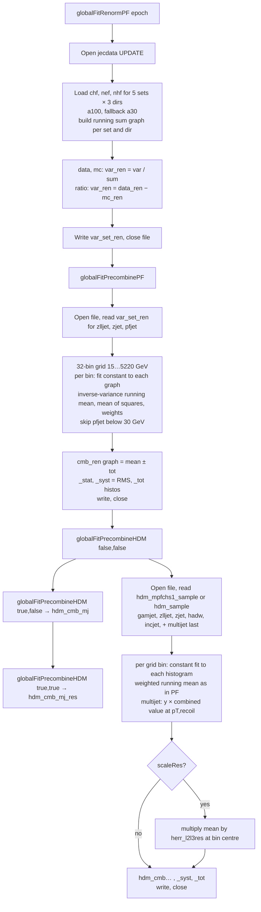

# globalFitRenormPF.C — what it does, how it flows, and the physics behind it

`globalFitRenormPF.C` is the fourth step of the jecsys L3Res chain, run after
`globalFitSyst.C` and before `globalFitL3Res.C`. It is a small (510 lines),
almost silent macro that works only on `rootfiles/jecdata<epoch>.root`
(opened in `UPDATE` mode) and does three independent things:

1. **Renormalise the PF composition** inputs (CHF, NEF, NHF) so that the
   three fractions add up to exactly 1.000 in data and in MC, and recompute
   the data − MC difference from the renormalised fractions. Inputs
   `<var>_<set>_a100` (or `_a30` for `pfjet`), outputs `<var>_<set>_ren`.
2. **Pre-combine the PF compositions** of all sets into one graph per
   variable on a common 32-bin pT grid (`<var>_cmb_ren`), with statistical,
   spread and total uncertainties.
3. **Pre-combine the HDM responses** (`hdm_mpfchs1_<sample>` from
   `softrad3.C`, `hdm_<sample>` from `globalFitSyst.C`) into one combined
   data/MC response curve on the same grid (`hdm_cmb`, `hdm_cmb_mj`,
   `hdm_cmb_mj_res`).

Items 2 and 3 are labelled "Bonus" in the source: they are for
visualisation and for `globalFitRun2.C`, not for `globalFitL3Res.C`. In the
present `DP_2021` configuration `globalFitL3Res.C` reads the *raw*
`chf/nhf/nef_<set>_a30|a100` graphs (`usePFC = false`), so nothing produced
here enters the 2016BCDEF global fit; `hdm_cmb_mj` is read by
`globalFitRun2.C` (line 566) for the Run 2 combination.

The worked example is the run

```
root -b -q 'mk_reprocess_RunEpoch.C("2016BCDEF")' > tmp_globalFitRenormPF.log 2>&1
```

with only `globalFitRenormPF(epoch)` active in `mk_reprocess.C`. The log has
806 lines: the five driver lines, 89 progress dots and 799 harmless ROOT fit
warnings (§5).

---

## 1. Inputs and outputs

**Inputs** (all from `rootfiles/jecdata2016BCDEF.root`, directories
`data/`, `mc/`, `ratio/`, η bin `eta00-13` only):

| object | used by | note |
|---|---|---|
| `<dir>/eta00-13/{chf,nef,nhf}_{zeejet,zmmjet,zlljet,zjet}_a100` | renormalisation | Z+jet PF fractions, α < 1.00 |
| `<dir>/eta00-13/{chf,nef,nhf}_pfjet_a30` | renormalisation | dijet ("PF jet") fractions; only α < 0.30 exists, picked up by the fallback |
| `<dir>/eta00-13/{chf,nef,nhf}_{zlljet,zjet,pfjet}_ren` | PF pre-combination | written by step 1 of the same run |
| `ratio/eta00-13/hdm_mpfchs1_{gamjet,zlljet,zjet}` | HDM pre-combination | HDM-corrected data/MC MPF response from `softrad3.C` |
| `ratio/eta00-13/hdm_hadw`, `hdm_incjet` | HDM pre-combination | from `globalFitSyst.C` (fallback name `hdm_<sample>`) |
| `ratio/eta00-13/hdm_mpfchs1_multijet`, `crecoil_multijet_a30` | HDM pre-combination (`addMJ`) | multijet ⟨R_lead⟩/⟨R_recoil⟩ and recoil pT fraction |
| `ratio/eta00-13/herr_l2l3res` | HDM pre-combination (`scaleRes`) | actual V7 L2L3Res JES from `reprocess.C` |

`gamjet` PF fractions are commented out (`// DP_2021`) in both PF lists.

**Outputs**, all written with `kOverwrite` into `eta00-13`:

```
{data,mc,ratio}/eta00-13/
  chf_<set>_ren, nef_<set>_ren, nhf_<set>_ren     TGraphErrors  set ∈ {zeejet,zmmjet,zlljet,zjet,pfjet}  (15 per dir)
  <var>_cmb_ren                                   TGraphErrors  combined fraction, error = total
  <var>_cmb_ren_stat                              TH1D          weighted mean, error = weighted mean of input errors
  <var>_cmb_ren_syst                              TH1D          same mean, error = RMS between sets
  <var>_cmb_ren_tot                               TH1D          same mean, error = sqrt(stat² + syst²)
ratio/eta00-13/
  hdm_cmb,        hdm_cmb_syst,        hdm_cmb_tot          TH1D  Z/γ/W/incjet combination
  hdm_cmb_mj,     hdm_cmb_mj_syst,     hdm_cmb_mj_tot       TH1D  + multijet chained to the recoil
  hdm_cmb_mj_res, hdm_cmb_mj_res_syst, hdm_cmb_mj_res_tot   TH1D  × herr_l2l3res (closure undone)
```

That is 45 + 36 + 9 = 90 objects. The file grew from 7.63 MB (after
`globalFitSyst.C`) to 7.87 MB.

---

## 2. Overall flowchart



Compact text version:

```
globalFitRenormPF(s)
 1. open jecdata<s>.root UPDATE
 2. for dir × var × set: read <var>_<set>_a100 (a30 for pfjet); sum_set[dir] += graph
 3. for dir × set × var: data/mc → g/sum ; ratio → data_ren − mc_ren
 4. write <var>_<set>_ren (45 graphs), close
 5. globalFitPrecombinePF(s)              → <var>_cmb_ren[_stat|_syst|_tot] in data, mc, ratio
 6. globalFitPrecombineHDM(s,false,false) → ratio/hdm_cmb[_syst|_tot]
 7. globalFitPrecombineHDM(s,true,false)  → ratio/hdm_cmb_mj[...]       (addMJ)
 8. globalFitPrecombineHDM(s,true,true)   → ratio/hdm_cmb_mj_res[...]   (addMJ + scaleRes)
```

Each of the four functions opens and closes the ROOT file itself, so the
file is opened four times in one run.

---

## 3. Stage-by-stage walkthrough (code view)

Line numbers refer to the current `globalFitRenormPF.C`.

### 3.1 Sets, variables, directories (lines 29–55)

| list | 2016BCDEF content | 2017H content |
|---|---|---|
| `sets` (renormalisation) | `zeejet`, `zmmjet`, `zlljet`, `zjet`, `pfjet` | `zjet`, `pfjet` |
| `vars` | `chf`, `nef`, `nhf` | same |
| `dirs` | `data`, `mc`, `ratio` | same |

### 3.2 Load and sum (lines 57–88)

For every (dir, var, set) the graph `<var>_<set>_a100` is fetched; if it
does not exist the `_a30` one is taken (this is how `pfjet` is read, line
75). A missing graph aborts via `assert`. A running sum graph per (set, dir)
is built with `tools::diffGraphs(g, gs, 1, -1)`, i.e. `1·g − (−1)·gs`
= `g + gs`. `diffGraphs` pairs points by nearest x, puts the result at the
mean x and adds the errors in quadrature. Every graph loaded prints one `.`
(45 dots).

### 3.3 Renormalise (lines 90–119)

* `data`, `mc`: `var_ren = tools::ratioGraphs(g, gs)` = `g / sum`.
  The error is `|g/sum|·sqrt((eg/g)² + (esum/sum)²)`; `g` is part of `sum`
  but the two are treated as independent, so the error is slightly
  inflated (e.g. CHF 0.0007 → 0.00095 at 17.7 GeV for Zll+jet data).
* `ratio`: `var_ren = tools::diffGraphs(data_ren, mc_ren)` = data − MC,
  the same convention as the input `ratio/` PF graphs written by
  `reprocess.C` (differences, not ratios). The x of the output point is
  the mean of the data and MC x (17.74 and 17.77 → 17.76).

### 3.4 Write (lines 121–143)

`<var>_<set>_ren` for 3 dirs × 3 vars × 5 sets, `kOverwrite`.

### 3.5 `globalFitPrecombinePF` (lines 163–325)

* Sets: `zlljet`, `zjet`, `pfjet` (`gamjet` commented out, `zeejet`/`zmmjet`
  not used since `zlljet` already merges them).
* Common grid `x[]` (lines 198–203): 32 bins,
  `15 20 25 30 35 40 45 50 60 | 70 85 130 | 175 230 300 400 500 | 592 686 790 905 1032 1172 1327 1497 | 1684 1890 2116 2366 2640 2941 3273 5220`.
  The groups follow the comment: Z/W only, +γ+jet, still Z/γ domain,
  multijet. Note the bin `[85,130]` has no edge at 105.
* For each (dir, var, set) and each grid bin: fit a constant `f1 = [0]`
  to the `_ren` graph restricted to the bin (`g->Fit(f1,"QRN")`), then,
  if the fit returned a non-zero error (something was fitted) and the bin
  is not excluded (`pfjet` below 30 GeV; `gamjet` below 70 GeV, moot),
  update the running inverse-variance mean (lines 254–268):

  ```
  w  = 1/σ²            (σ = fit error of the constant)
  hs   = (Σ w·y)  / Σ w          weighted mean
  hs2  = (Σ w·y²) / Σ w          weighted mean of squares
  hsw  =  Σ w
  err(hs) = (Σ w·σ) / Σ w        weighted mean of the input errors (NOT 1/sqrt(Σw))
  ```

* Output (lines 282–321): `hs3` = clone with error
  `sqrt(|hs2 − hs²| + err²)` = `_tot`; `hs2` rewritten with content `hs`
  and error `sqrt(|hs2 − hs²|)` (RMS between sets) = `_syst`; `hs` =
  `_stat`. The graph `<var>_cmb_ren` is `TGraphErrors(hs3)` with the
  zero-error (empty) bins removed, so it has 27 points for 2016BCDEF.

The weight recipe means the combined "stat" error is the weighted mean of
the per-set errors, roughly the error of a single typical set rather than
the error of the combination. The RMS is zero wherever only one set
contributes (above 300 GeV only `pfjet` is left), so there `_tot = _stat`.

### 3.6 `globalFitPrecombineHDM` (lines 329–510)

Same machinery applied to histograms, `ratio` directory only.

* Sets: `gamjet`, `zlljet`, `zjet`, `hadw`, plus `incjet` for every epoch
  except `Run2Test`, plus `multijet` **last** when `addMJ` (the comment
  says why: it is referenced to everything before it).
* Histogram lookup (lines 381–384): `hdm_mpfchs1_<set>` first, else
  `hdm_<set>`. For 2016BCDEF this resolves to `hdm_mpfchs1_gamjet`,
  `hdm_mpfchs1_zlljet`, `hdm_mpfchs1_zjet` (from `softrad3.C`),
  `hdm_hadw`, `hdm_incjet` (from `globalFitSyst.C`) and
  `hdm_mpfchs1_multijet`. A miss prints `Missing ratio/hdm[X]_<set>` and
  asserts.
* Per bin constant fit on the histogram, same weighted mean (lines
  405–444), with the multijet special case (lines 423–436):

  ```
  ptlead = bin centre
  ptrec  = crecoil_multijet_a30(ptlead) · ptlead           recoil pT (≈ 0.46·ptlead at 133 GeV)
  yref   = hs[bin containing ptrec]                       combined response of the others at ptrec
  y      = MJB·yref,  σ² = (σ_MJB·yref)² + σ_yref²
  ```

  i.e. the multijet ⟨R_lead⟩/⟨R_recoil⟩ is multiplied by the already
  combined Z/γ/W/incjet response at the recoil pT, turning it into an
  absolute response of the leading jet.
* `scaleRes` (lines 458–468): multiply `hs` by `herr_l2l3res` at the bin
  centre and `hs2` by its square, before the RMS is formed.
* Output names (lines 487–500): `hdm_cmb` + `_mj` if `addMJ` + `_res` if
  `scaleRes`, each with `_syst` and `_tot` companions. The template
  histogram `h1_hdm_<epoch>` is re-created on every call, which gives the
  two `TROOT::Append: Replacing existing TH1: h1_hdm_2016BCDEF` warnings.

---

## 4. Physics view

### 4.1 Why renormalise the PF fractions

The global fit (`globalFitL3Res.C`) uses the data − MC differences of the
jet PF energy fractions as an extra handle on *which* detector effect
causes a response difference: a tracking inefficiency lowers CHF and
raises NEF/NHF, a photon-scale change moves NEF, an HCAL scale change moves
NHF, etc. (shapes from `minitools/varPlots.C`, stored in `_mpf` in
`globalFitL3Res.C`). These shapes are derived assuming
CHF + NEF + NHF = 1 for the three "hadronic" components. In the inputs the
three fractions add up to ≈ 0.989 (Zll+jet at 17.7 GeV: 0.5765 + 0.2729 +
0.1392 = 0.9886 in data, 0.9888 in MC) because muons, electrons and the
HF fractions are left out, and the deficit depends a little on pT and on
the sample. Dividing by the sum removes this normalisation freedom so that
a shift in one fraction must be compensated by the others, as in the
model. The data − MC *difference* changes very little (CHF −0.00882 →
−0.00879 at 17.7 GeV) because data and MC are renormalised by almost the
same factor; the main effect is on the absolute fractions
(CHF 0.5765 → 0.5832).

### 4.2 Combining PF fractions across samples

The dijet (`pfjet`) and Z+jet fractions probe the same jets in different
pT ranges and with different quark/gluon mixtures. Pre-combining them per
grid bin gives one smooth data − MC curve from 15 GeV to 2 TeV for plots
and for the `usePFC` option of the fit. The RMS between sets is kept as a
"syst" to flag where Z+jet and dijet disagree: for CHF the RMS is 0.2 %
at 15–25 GeV (Zll+jet −0.88 % vs Z+jet(UH) −1.27 %) and 0.1–0.4 % between
30 and 230 GeV, compared with a stat error of 0.1–0.2 %.

### 4.3 Combining HDM responses: one response curve for Run 2

`hdm_mpfchs1_<sample>` is the FSR-corrected data/MC MPF response from
`softrad3.C`, i.e. the quantity the L3Res fit models. Averaging it over
Z+jet (15–700 GeV), γ+jet (40–1200 GeV), W→qq' (70–175 GeV) and inclusive
jets (21–1890 GeV) gives a direct, model-independent estimate of the
residual response ratio versus pT, which `globalFitRun2.C` uses to compare
and combine the four Run 2 years.

Multijet is a *relative* measurement, ⟨R_lead⟩/⟨R_recoil⟩ with the recoil
at ≈ 0.4–0.5 × pT,lead. Chaining it to the combined response of the other
samples at the recoil pT converts it into an absolute response and extends
the curve to 2 TeV; that is why multijet must come last and why `hdm_cmb_mj`
differs from `hdm_cmb` only from the first multijet bin `[130,175]` on.

`hdm_cmb_mj_res` multiplies by the V7 L2L3Res JES (`herr_l2l3res`). The
inputs are a closure test (`CorLevel = L1L2L3Res`, see `reprocess.md`), so
`hdm_cmb_mj` ≈ 1 means "V7 is right". Multiplying by V7 gives the
absolute data/MC response ratio that a *new* L3Res would have to correct:
0.997 at 17.5 GeV, 0.965 at 50 GeV, 0.975 at 350 GeV, 0.988 at 1.8 TeV.

A caveat on the statistics: `zlljet` (KIT) and `zjet` (UH) are two
analyses of the same Z+jet data, yet they enter the average as independent
inputs; and the combined error is the weighted mean of the inputs' errors
(§3.5). The numbers are meant for plotting and cross-checks, not for a
χ² fit.

---

## 5. Worked example: reading `tmp_globalFitRenormPF.log` for 2016BCDEF

### 5.1 Structure

```
Processing mk_reprocess_RunEpoch.C("2016BCDEF")...
/afs/cern.ch/work/r/rverma/public/JME/jecsys
Error in <TUnixSystem::FindDynamicLibrary>: .../jec-fit-prototype/lib/libjecfit[...] does not exist   harmless, see missing.md
Run2Test
2016BCDEF
.............................................. (46 dots)      45 renormalisation loads + first PrecombinePF load
Warning in <Fit>: Fit data is empty            ×19            PrecombinePF: zlljet, 19 empty grid bins
.Warning in <Fit>: Fit data is empty           ×19            zjet
.Warning in <Fit>: Fit data is empty           ×5             pfjet (bins above 2116 GeV)
   ... repeated for 3 vars × 3 dirs (27 dots, 387 warnings)
.  ×5  with "Fit data is empty" and "fit range is outside histogram range"   PrecombineHDM call 1: gamjet, zlljet, zjet, hadw, incjet
Warning in <TROOT::Append>: Replacing existing TH1: h1_hdm_2016BCDEF (Potential memory leak).
.  ×6  (… + multijet)                                                        call 2 (addMJ)
Warning in <TROOT::Append>: Replacing existing TH1: h1_hdm_2016BCDEF (Potential memory leak).
.  ×6                                                                        call 3 (addMJ + scaleRes)
```

Dot accounting: 45 + 27 + 5 + 6 + 6 = 89.

### 5.2 Warnings and what they mean

| log text | count | cause | consequence |
|---|---|---|---|
| `Warning in <Fit>: Fit data is empty` | 661 | the per-bin constant fit found no graph point / no filled histogram bin inside the grid bin. PrecombinePF: 19 per Z+jet set (points span 17.8–200 GeV, so 19 of 32 bins are empty), 5 for `pfjet` (above 2058 GeV). PrecombineHDM per call: gamjet 16, zlljet 14, zjet 14, hadw 29, incjet 7, multijet 17 | none: the bin is skipped (`GetParError==0`) |
| `Warning in <ROOT::Fit::FillData>: fit range is outside histogram range` | 138 | TH1::Fit variant of the same thing for grid bins lying entirely outside the histogram's axis: per call gamjet 6 (above 1750), zlljet/zjet 7 each (above 1500), hadw 20 (below 30 and above 230), incjet 6 (below 21, above 2116) | none |
| `Warning in <TROOT::Append>: Replacing existing TH1: h1_hdm_2016BCDEF` | 2 | the grid template histogram is created anew in each of the three `globalFitPrecombineHDM` calls with the same name | none |

`hdm_hadw` has 11 bins (30–230 GeV) but only four are filled (70–175 GeV),
hence the large number of empty-fit warnings for hadW.

### 5.3 What ended up in the file

Renormalisation, Zll+jet, first pT bin (17.7 GeV):

| | CHF | NEF | NHF | sum |
|---|---|---|---|---|
| data `_a100` | 0.5765 ± 0.0007 | 0.2729 ± 0.0006 | 0.1392 ± 0.0006 | 0.9886 |
| data `_ren` | 0.5832 ± 0.0010 | 0.2761 ± 0.0007 | 0.1408 ± 0.0006 | 1.0000 |
| MC `_a100` | 0.5854 ± 0.0010 | 0.2687 ± 0.0008 | 0.1348 ± 0.0008 | 0.9888 |
| MC `_ren` | 0.5920 ± 0.0013 | 0.2717 ± 0.0009 | 0.1364 ± 0.0008 | 1.0000 |
| ratio `_a100` (data − MC) | −0.00882 ± 0.0012 | +0.00427 ± 0.0010 | +0.00433 ± 0.0009 | |
| ratio `_ren` (data − MC) | −0.00879 ± 0.0016 | +0.00438 ± 0.0011 | +0.00441 ± 0.0010 | |

Combined CHF difference `ratio/eta00-13/chf_cmb_ren` (27 points):

| pT bin (GeV) | CHF data − MC | stat | RMS between sets | contributing sets |
|---|---|---|---|---|
| 15–20 | −0.0109 | 0.0016 | 0.0019 | zlljet, zjet |
| 30–35 | −0.0088 | 0.0013 | 0.0007 | zlljet, zjet, pfjet |
| 85–130 | −0.0150 | 0.0012 | 0.0009 | zlljet, zjet, pfjet |
| 175–230 | −0.0152 | 0.0019 | 0.0024 | zlljet, zjet, pfjet |
| 300–400 | −0.0205 | 0.0010 | 0 | pfjet |
| 905–1032 | −0.0354 | 0.0011 | 0 | pfjet |
| 1890–2116 | −0.0292 | 0.0058 | 0 | pfjet |

Data have 1 % less CHF than MC at low pT, growing to 3.5 % at 1 TeV,
compensated by NEF (+0.5 → +1 %) and NHF (+0.6 % at 17 GeV, +2.5 % at
1 TeV).

Combined HDM response `ratio/eta00-13/`:

| pT bin (GeV) | `hdm_cmb` | `hdm_cmb_mj` | `hdm_cmb_mj_res` | RMS (`_syst`, cmb) |
|---|---|---|---|---|
| 15–20 | 1.0229 ± 0.0050 | 1.0229 | 0.9974 | 0.0042 |
| 30–35 | 0.9987 ± 0.0011 | 0.9987 | 0.9698 | 0.0005 |
| 50–60 | 0.9919 ± 0.0016 | 0.9919 | 0.9648 | 0.0025 |
| 85–130 | 0.9955 ± 0.0009 | 0.9955 | 0.9720 | 0.0019 |
| 130–175 | 0.9965 ± 0.0011 | 0.9961 | 0.9736 | 0.0032 |
| 300–400 | 0.9932 ± 0.0008 | 0.9930 | 0.9757 | 0.0008 |
| 905–1032 | 0.9911 ± 0.0010 | 0.9909 | 0.9793 | 0.0004 |
| 1684–1890 | 0.9950 ± 0.0037 | 0.9945 | 0.9882 | ~0 |
| 1890–2116 | — | 0.9915 ± 0.015 | 0.9869 | — |

The inputs behind the first bin are Zll+jet 1.0275 ± 0.0053 and Z+jet(UH)
1.0191 ± 0.0047 (γ+jet starts at 40 GeV, inclusive jets at 21 GeV); the
combined closure is +2.3 % at 17.5 GeV and
−0.5 to −0.9 % between 50 GeV and 1 TeV, the same pattern the global fit
has to accommodate (see `globalFitL3Res.md`).

---

## 6. Practical notes and quirks

* The macro is idempotent (`kOverwrite`) and only touches `eta00-13`; it
  must run after `softrad3.C` (needs `hdm_mpfchs1_*`) and
  `globalFitSyst.C` (needs `hdm_hadw`, `hdm_incjet`), otherwise it asserts
  with `Missing ratio/hdm[X]_<set>`.
* `gamjet` is excluded from both PF lists by the `DP_2021` revert, but is
  still part of the HDM combination.
* `usePFC = false` in `globalFitL3Res.C`, so `<var>_cmb_ren` is not used
  by the 2016BCDEF fit; the fit reads `chf_pfjet_a30` and `chf_zjet_a100`
  (not even the `_ren` versions). The `_ren` and `_cmb_ren` objects are
  for plots and for `globalFitRun2.C`.
* `incjet` is included in the HDM combination for every epoch except
  `Run2Test` (`if (s!="Run2Test") sets.push_back("incjet")`); for 2017H
  only `zjet` is used and the `scaleRes` variant is produced without
  multijet.
* The ratio in `ratioGraphs` treats numerator and denominator as
  independent although the numerator is part of the sum, and the combined
  "stat" error is a weighted *mean* of the input errors. Both are
  conservative/approximate and documented in the code comments as
  "pre-combine for easier plotting / fitting".
* Expect ~800 `Fit data is empty` / `fit range is outside histogram range`
  warnings per run; they are the normal consequence of fitting a sparse
  graph bin by bin on a 32-bin grid.
