# globalFitSyst.C — what it does, how it flows, and the physics behind it

`globalFitSyst.C` is the third step of the jecsys L3Res chain. It is short
(381 lines) and silent: for the run

```
root -b -q 'mk_reprocess_RunEpoch.C("2016BCDEF")' > tmp_globalFitSyst.log 2>&1
```

with `reprocess` and `softrad3` commented out in `mk_reprocess.C`, the log
contains only the five driver lines (the harmless `libjecfit` error,
`Run2Test`, `2016BCDEF`). Everything it does is visible only in
`rootfiles/jecdata2016BCDEF.root`, which it opens in `UPDATE` mode.

Its job is to prepare the **sample-specific systematic uncertainty
sources** that `globalFitL3Res.C` will use as nuisance parameters, and a
few **"HDM variant" response histograms** for `globalFitRenormPF.C` and
`globalFitRun2.C`. The generic FSR systematics were already produced by
`softrad3.C` (`fsr/hkfsr3_*`); this macro adds the channel-specific ones
that come from external studies (JER, lepton/photon scale, ECAL gain
switch, hadronic-W selection and parton shower).

---

## 1. Inputs and outputs

**Inputs**

| what | where | used by block |
|---|---|---|
| `ratio/eta00-13/fsr/hkfsr3_ptchs_multijet` | `jecdata2016BCDEF.root` | binning template for `jer_multijet` |
| `ratio/eta00-13/fsr/hkfsr3_mpfchs1_gamjet` | same | binning template for `zee_gamjet_eig*` |
| `ratio/eta00-13/counts_hadw_a30` | same | binning template for `hadw_*_fitprob*` |
| `ratio/eta00-13/hdm_mpfchs1_gamjet` | same | `hdm_gamjet` |
| `ratio/eta00-13/mpfchs1_hadw_a30` | same | `ghdm_hadw`, `hdm_hadw` |
| `ratio/eta00-13/mpfchs1_incjet_a100` | same | `ghdm_incjet`, `hdm_incjet` |
| `control/pgain1vspt`, `control/pgain6vspt` | `DP2021033V2/GamHistosFill_data_2018ABCD_v19.root` (2018 data, used for every epoch) | `gamjet_gain1/6` |
| `pmm13bptave`, `pmm13bptave_FSRup`, `pmm13bptave_FSRdw` | `rootfiles/hadWMC16GHV7_JEC.root` (currently a labelled stand-in symlink, see §6) | `hadw_fsr`, `hadw_*_fsr`, `hdm_hadw` |
| `ratio/eta00-13/hdm_cmb_mj` | `rootfiles/jecdataRun2Test.root` (archived Run 2 combination) | `hdm_incjet` |
| hard-coded fit parameters | from `minitools/systMultijet.C`, `minitools/drawZmass.C`, `minitools/hadW.C` | all |

**Outputs**, all written with `kOverwrite` into `ratio/eta00-13/`:

```
ratio/eta00-13/sys/                  (new directory, 12 TH1D)
  jer_multijet                       multijet JER-SF sensitivity, applies to MPF and MJB
  zee_gamjet_eig0, eig1, eig2        photon energy scale eigenvectors from the Zee mass fit
  gamjet_gain1, gamjet_gain6         fraction of photons on ECAL gain-1 / gain-6 path (×0.01)
  hadw_ptave_fitprob                 W→qq' fit-probability cut dependence, pT,ave observable
  hadw_ptboth_fitprob                same for pT,both observable
  hadw_ptave_fitprob2, ptboth_fitprob2   difference between two functional forms
  hadw_ptave_fsr, hadw_ptboth_fsr    (FSRup − FSRdw)/nominal from PS weights
ratio/eta00-13/fsr/hadw_fsr          1 + (FSRup − FSRdw)/nominal, multiplicative FSR correction for hadW
ratio/eta00-13/hdm_gamjet            copy of hdm_mpfchs1_gamjet (gain terms × 0)
ratio/eta00-13/ghdm_hadw, hdm_hadw   mpfchs1_hadw_a30 divided by hadw_fsr (graph and histogram)
ratio/eta00-13/ghdm_incjet, hdm_incjet   mpfchs1_incjet_a100 × Run 2 combined multijet HDM factor
```

The file grew from 7.49 MB to 7.63 MB. Only the `|η| < 1.3` ratio
directory is touched.

---

## 2. Overall flowchart

```mermaid
flowchart TD
    A[globalFitSyst run] --> B[Open jecdata&lt;run&gt;.root UPDATE<br/>cd ratio/eta00-13, locate fsr/, create sys/]
    B --> C{doMultijetJER}
    C --> D[jer_multijet = 0.01 × mean of<br/>leading and recoil JER fits, 114&lt;pT&lt;2000]
    D --> E{doGamMass}
    E --> F[Covariance of Zee mass fit params<br/>→ eigen-decomposition<br/>→ zee_gamjet_eig0..2 evaluated at 2·pT,γ]
    F --> G{doGamGains}
    G --> H[gain1, gain6 profiles from 2018 photon file ×0.01<br/>hdm_gamjet = hdm_mpfchs1_gamjet − 0·gain1 − 0·gain6]
    H --> I{doHadWfitProb}
    I --> J[hadw_ptave/ptboth_fitprob = 0.01·f&#40;pT&#41;<br/>fitprob2 = 0.01·&#40;f2 − f&#41;]
    J --> K{doHadWfsr}
    K --> L[hadw_fsr = 1 + &#40;up − dw&#41;/mc → fsr/<br/>ghdm_hadw, hdm_hadw = mpfchs1_hadw / hadw_fsr<br/>hadw_ptave_fsr = hadw_ptboth_fsr = &#40;up − dw&#41;/mc → sys/]
    L --> M{doIncjetHDM}
    M --> N[href = hdm_cmb_mj from jecdataRun2Test.root<br/>ghdm_incjet, hdm_incjet = mpfchs1_incjet × href]
    N --> O[Close file]
```



Text version:

```
globalFitSyst(run)
 1. open jecdata<run>.root (UPDATE); dirs d2 = ratio/eta00-13, dfsr = d2/fsr, dsys = d2/sys (created)
 2. doMultijetJER  -> sys/jer_multijet
 3. doGamMass      -> sys/zee_gamjet_eig{0,1,2}
 4. doGamGains     -> sys/gamjet_gain{1,6}, d2/hdm_gamjet
 5. doHadWfitProb  -> sys/hadw_{ptave,ptboth}_fitprob{,2}
 6. doHadWfsr      -> fsr/hadw_fsr, d2/ghdm_hadw, d2/hdm_hadw, sys/hadw_{ptave,ptboth}_fsr
 7. doIncjetHDM    -> d2/ghdm_incjet, d2/hdm_incjet
 8. close
```

All six switches are `true`; only `run == "2017H"` (low pile-up) turns the
first five off.

---

## 3. Block-by-block walkthrough (code view)

Line numbers refer to the current `globalFitSyst.C`.

### 3.1 Setup (lines 24–47)

Opens the file, asserts that `ratio/eta00-13/fsr` exists (so `softrad3.C`
must have run), creates `ratio/eta00-13/sys` if missing. `multijetModeS =
"ptave"` must match `multijetMode` in `reprocess.C`; it is not checked
automatically.

### 3.2 Multijet JER (lines 49–97)

Two fits from `minitools/systMultijet.C` on UL17BCDEF give the change of
the multijet balance (in %) when the JER scale factor is varied, as a
function of pT:

```
f(pT) = p0 + p1 · (0.01 pT)^p2
recoil  binning: (0.138, −0.993, −0.561)
leading binning: (0.192, −0.384, −3.260)
```

For `ptave` binning the code takes the mean of the two ("placeholder for
actual updated JER"), multiplies by 0.01 and fills the bins with
114 < pT < 2000 GeV of a clone of `hkfsr3_ptchs_multijet`. Only one
histogram is written, `sys/jer_multijet` (the `ptchs` clone `h2` is
computed but discarded).

### 3.3 Photon energy scale from the Zee mass fit (lines 100–177)

`reprocess.C` scaled photon+jet by the Zee mass-ratio function
`f1mgam(pT) = p0 + p1·L + p2·L²`, `L = log(0.01·pT)`, evaluated at
pT = 2·pT,γ. This block propagates the **fit uncertainty** of that
function as three independent shapes:

1. Build the 3×3 covariance matrix `emat` of (p0, p1, p2) from the six
   numbers stored as the `f1egam` parameters (diagonal: variances;
   off-diagonal: covariances).
2. Eigen-decompose: `emat = Q Λ Qᵀ` (`TMatrixD::EigenVectors`).
3. For each eigenvalue λ_k with eigenvector column Q[·][k], define the
   function with parameters `p_i = Q[i][k]·√λ_k` and evaluate it at
   `2·pT` for every bin of a clone of `hkfsr3_mpfchs1_gamjet`.
4. Write `sys/zee_gamjet_eig0`, `eig1`, `eig2`. They are signed, relative,
   and their quadrature sum reproduces `f1egam(2·pT)` exactly (checked on
   the output: 0.00019 at 45 GeV, 0.00388 at 1100 GeV).

The covariance used is the one labelled "17Nov17_V10 BCDEF (EOY2017)",
copied once and never updated per epoch, whereas `reprocess.C` applies
the UL16APV central function. See §6.

### 3.4 ECAL gain switch (lines 180–217)

From the 2018 photon+jet data control file, the profiles of the fraction
of photons reconstructed on the ECAL gain-1 and gain-6 paths vs pT are
projected, scaled by 0.01 (percent → fraction) and stored as
`sys/gamjet_gain1`, `sys/gamjet_gain6`. High-energy crystals switch gain,
and the response on those paths is calibrated separately, so these
fractions are the shapes along which a gain-path scale error would act.

`hdm_gamjet` is then created as `hdm_mpfchs1_gamjet − 0.0·gain1 −
0.0·gain6`: the coefficients are set to 0 ("0 to match Zll+jet"), so it is
an identical copy (max difference 0 in the output). It exists so that
`globalFitRenormPF.C` / `globalFitRun2.C` can read every sample through
one name pattern, `hdm_<sample>`.

### 3.5 Hadronic W fit-probability dependence (lines 219–272)

`minitools/hadW.C::DrawFP()` scanned the fit-probability cut of the
kinematic tt̄ fit and parametrised the shift of the W→qq' response:

```
f(pT)  = p0 + p1 / (log(pT/0.218) · pT)        UL18: (0.95564, −139) ptave, (0.99556, −128.37) ptboth
f2(pT) = p0 + |p1| / log(pT/0.218)             (0.57464, ~0) ptave, (0.65814, ~0) ptboth
```

`sys/hadw_ptave_fitprob` and `_ptboth_fitprob` = 0.01·f(pT);
`_fitprob2` = 0.01·(f2 − f), the difference between the two functional
forms, i.e. a shape uncertainty on the shape. Binning from
`counts_hadw_a30` (11 bins, 30–230 GeV). The UL18 parameters are used for
all epochs.

### 3.6 Hadronic W parton-shower FSR (lines 274–334)

From UL16GH MC with PS weights, the W mass-peak response profile vs
pT,ave is read for nominal, FSR μ=0.5 (`FSRup`) and μ=2 (`FSRdw`):

```
fsr/hadw_fsr           = 1 + (up − dw)/mc       multiplicative correction
sys/hadw_ptave_fsr     =     (up − dw)/mc       relative uncertainty shape
sys/hadw_ptboth_fsr    =     same (ptboth is a clone of ptave)
ghdm_hadw, hdm_hadw    = mpfchs1_hadw_a30 / hadw_fsr   (point by point; errors scaled, FSR error not added)
```

The full up−dw difference is taken as one sigma ("expected about 1–2σ
shift on FSR → 1σ shift"), with scale 1.0 chosen for the "better match to
zjet and gamjet".

### 3.7 Inclusive jets HDM variant (lines 336–377)

Reads `ratio/eta00-13/hdm_cmb_mj` from the archived
`rootfiles/jecdataRun2Test.root` (the Run 2 combined multijet HDM
response, output of a previous `globalFitRun2`/`recombine` pass) and
multiplies the inclusive-jet ratio graph by it bin by bin, so that the
inclusive-jet input is on the same footing as the HDM-corrected multijet.
Stored as `ghdm_incjet` (graph) and `hdm_incjet` (TH1D with bin edges from
the graph's x ± ex). Bins outside `hdm_cmb_mj`'s range get factor 0: the
last point at 2058 GeV is zeroed in this run.

---

## 4. Physics view

### 4.1 Why these are separate from the FSR systematics

The global fit (`globalFitL3Res.C`) minimises a χ² over all channels with
nuisance parameters for each **source**: a signed, relative, pT-dependent
shape `s_k(pT)` that multiplies the response of the samples it applies to,
`R → R·(1 + θ_k·s_k)`, with a unit Gaussian penalty on θ_k. `softrad3.C`
provides the sources common to all balance channels (Rn, Ru variations).
`globalFitSyst.C` provides the sources that exist for only one channel:

| source | channel | physics origin | typical size for 2016BCDEF |
|---|---|---|---|
| `jer_multijet` | multijet MPF+MJB | the multijet balance in pT,ave bins depends on the JER smearing of the recoil; a ±1σ change of the JER SF moves it | −0.3 % at 134 GeV → 0 above ~700 GeV |
| `zee_gamjet_eig0..2` | γ+jet MPF+DB | the photon scale is tied to the Zee scale; the Zee mass fit has three correlated parameters, so three eigen-shapes | eig0 −0.3 % at 1.1 TeV, eig1 +0.2 %, eig2 +0.06 %; ~0 below 100 GeV |
| `hadw_*_fitprob` | W→qq' MPF slot and DB slot separately | the extracted W response depends on the kinematic-fit probability cut (selection of well-reconstructed tt̄) | +0.4 % at 45 GeV → +0.9 % at 200 GeV |
| `hadw_*_fitprob2` | same | difference between two parametrisations of that dependence | +0.16 % → −0.28 % |
| `hadw_fsr` (correction) | W→qq' | the W peak response shifts with the amount of FSR in the shower; nominal data are corrected by 1 + (up−dw)/mc | 0.9958 at 55 GeV → 0.9996 at 200 GeV, i.e. hadW points raised by 0.0–0.4 % |

The `bm<mask>_` prefix that `globalFitL3Res.C` gives these when it loads
them encodes which (sample, method) pairs a source acts on, bit
`1<<(sample index)` for MPF and `1<<(nsamples + sample index)` for pT
balance. `jer_multijet` gets both bits, the hadW `ptave` and `ptboth`
sources get one bit each, the photon EES eigenvectors get both.

### 4.2 Eigenvector decomposition of a fit covariance

A fitted function `f(pT; p)` with parameter covariance `C` has uncertainty
`σ_f²(pT) = ∇f ᵀ C ∇f`. Writing `C = Q Λ Qᵀ`, the vectors
`v_k = √λ_k Q[·][k]` satisfy `Σ_k v_k v_kᵀ = C`, so the shapes
`s_k(pT) = ∇f ᵀ v_k` (here simply `f(pT; v_k)` because `f` is linear in
`p`) are uncorrelated, each one sigma, and `Σ_k s_k² = σ_f²`. This is how
three correlated parameters become three independent nuisance parameters
with the right total uncertainty. The same technique is used later in
`globalFitL3Res.C` to export the fit result (`hjesfit_eig%d`).

### 4.3 The "HDM variants" (`hdm_*`, `ghdm_*`)

`globalFitRenormPF.C` and `globalFitRun2.C` read one histogram per
sample named `hdm_<sample>` from `ratio/eta00-13/`. For Z+jet and γ+jet
these are the `softrad3.C` outputs; for hadW and inclusive jets, which
have no MPF decomposition, this macro builds the analogue by applying the
available correction (PS-weight FSR for hadW, Run 2 multijet HDM factor
for inclusive jets). `hdm_gamjet` is a renamed copy of the softrad3
result since the gain correction is switched off.

---

## 5. Worked example: 2016BCDEF

### 5.1 Log

```
Processing mk_reprocess_RunEpoch.C("2016BCDEF")...
/afs/cern.ch/work/r/rverma/public/JME/jecsys
Error in <TUnixSystem::FindDynamicLibrary>: .../jec-fit-prototype/lib/libjecfit[...] does not exist ...
Run2Test
2016BCDEF
```

Nothing from `globalFitSyst` itself. A failure would show as an
`Assertion failed` abort (missing input object or file); success is
silent.

### 5.2 Output values

`ratio/eta00-13/sys/` after the run:

| histogram | 45 | 78 | 118 | 202 | 450 | 775 | 1100 GeV |
|---|---|---|---|---|---|---|---|
| `zee_gamjet_eig0` | +0.0001 | +0.0001 | −0.0000 | −0.0004 | −0.0015 | −0.0025 | −0.0033 |
| `zee_gamjet_eig1` | −0.0001 | +0.0001 | +0.0003 | +0.0006 | +0.0011 | +0.0016 | +0.0019 |
| `zee_gamjet_eig2` | +0.0001 | +0.0002 | +0.0002 | +0.0002 | +0.0004 | +0.0005 | +0.0006 |
| `gamjet_gain1` | 0 | 0 | 0 | 0 | +0.0042 | +0.0093 | +0.0100 |
| `gamjet_gain6` | 0 | 0 | 0 | +0.0022 | +0.0055 | +0.0007 | 0 |

| histogram | 134 | 220 | 396 | 738 | 1250 | 2003 GeV |
|---|---|---|---|---|---|---|
| `jer_multijet` | −0.0033 | −0.0017 | −0.0007 | +0.0000 | +0.0004 | +0.0000 |

| histogram | 45 | 55 | 78 | 95 | 118 | 152 | 202 GeV |
|---|---|---|---|---|---|---|---|
| `hadw_ptave_fitprob` | +0.0041 | +0.0050 | +0.0065 | +0.0071 | +0.0077 | +0.0082 | +0.0086 |
| `hadw_ptboth_fitprob` | +0.0049 | +0.0057 | +0.0071 | +0.0077 | +0.0082 | +0.0087 | +0.0090 |
| `hadw_ptave_fitprob2` | +0.0016 | +0.0008 | −0.0008 | −0.0014 | −0.0019 | −0.0024 | −0.0028 |
| `hadw_ptave_fsr` | −0.0038 | −0.0042 | −0.0042 | −0.0040 | −0.0027 | −0.0014 | −0.0004 |
| `fsr/hadw_fsr` | 0.9962 | 0.9958 | 0.9958 | 0.9960 | 0.9973 | 0.9986 | 0.9996 |

HDM variants in `ratio/eta00-13/`:

| hadW point (GeV) | `mpfchs1_hadw_a30` | `ghdm_hadw` | factor |
|---|---|---|---|
| 76.7 | 0.9969 | 1.0011 | 0.9958 |
| 93.8 | 0.9995 | 1.0035 | 0.9960 |
| 115.5 | 0.9984 | 1.0010 | 0.9973 |
| 146.8 | 1.0043 | 1.0057 | 0.9986 |

| incjet point (GeV) | `mpfchs1_incjet_a100` | `ghdm_incjet` | `hdm_cmb_mj` factor |
|---|---|---|---|
| 22 | 1.0049 | 1.0050 | 1.0002 |
| 46 | 0.9966 | 0.9951 | 0.9984 |
| 346 | 0.9932 | 0.9927 | 0.9995 |
| 764 | 0.9936 | 0.9929 | 0.9993 |
| 2058 | 0.9930 | 0.0000 | 0 (outside `hdm_cmb_mj` range) |

`hdm_gamjet` equals `hdm_mpfchs1_gamjet` bin by bin.

### 5.3 Where each output goes next

| object | consumer |
|---|---|
| `sys/jer_multijet` | `globalFitL3Res.C` line 1476, source `bm*_multijet_jer_src0` on multijet MPF and MJB |
| `sys/zee_gamjet_eig0..2` | `globalFitL3Res.C` line 1602, sources `bm*_eesfromzee_gamjet_eig*` on γ+jet |
| `sys/hadw_ptave_fitprob`, `_ptboth_fitprob`, `_fitprob2` | `globalFitL3Res.C` lines 1555–1590, sources `bm*_hadw_*_fitprob*` |
| `fsr/hadw_fsr` | `globalFitL3Res.C` line 1068, FSR correction applied to the hadW points |
| `hdm_gamjet`, `hdm_hadw`, `hdm_incjet` | `globalFitRenormPF.C` line 387 (`hdm_<sample>` pattern), `globalFitRun2.C` |
| `sys/gamjet_gain1/6`, `sys/hadw_ptave_fsr`, `sys/hadw_ptboth_fsr`, `ghdm_*` | written but not read by any `globalFit*.C` in the current tree |

---

## 6. Practical notes and quirks

* **Epoch mismatches** (all deliberate placeholders in the `DP_2021`
  state): multijet JER fits are UL17BCDEF; hadW fit-probability
  parameters are UL18; the photon gain profiles are 2018 data; the Zee
  covariance is EOY2017 (`17Nov17_V10`) although the central mass
  correction in `reprocess.C` is the UL16APV fit. Only the hadW PS-weight
  FSR file is nominally UL16 (GH).
* **Stand-in input**: `rootfiles/hadWMC16GHV7_JEC.root` is a symlink to a
  file rebuilt from the archived `jecdataRun2Test.root` so that `hadw_fsr`
  is reproduced bin by bin (see `missing.md` sec. 2f and
  `rootfiles/README_hadW_standin.txt`). Bin errors of `hadw_*_fsr` are not
  reproduced, but they are not propagated anywhere. Replace the symlink
  and rerun from this step when the real file arrives.
* **Dependency on the archived Run 2 file**: `hdm_incjet` needs
  `hdm_cmb_mj` from `rootfiles/jecdataRun2Test.root`, which is itself an
  output of a later stage of the chain (`globalFitRun2`). For a per-year
  run this uses whatever that file currently contains; the assert is
  relaxed only for `run == "Run2Test"`.
* **Only `ratio/eta00-13`** is processed. No `sys/` directory is created
  for `eta00-25` or for `data/` and `mc/`.
* `multijetModeS` is a copy of `multijetMode` in `reprocess.C`; keep them
  in sync by hand.
* The `ptchs_multijet_src0` clone is filled but never written; the `ptchs`
  JER source is the same histogram as the MPF one.
* The photon-gain subtraction coefficients in `hdm_gamjet` are 0.0 with
  the comment "0.5 to match zjet, 0 to match Zll+jet": the choice is a
  tuning knob, not a derived number.
* Re-running is safe: everything is `kOverwrite`, and `sys/` is created
  only once.
