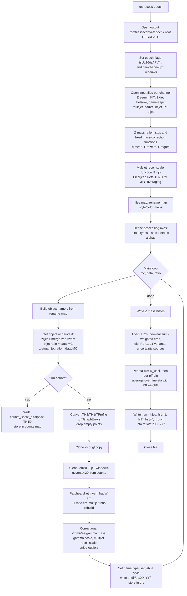

# reprocess.C — what it does, how it flows, and the physics behind it

`reprocess.C` is the first step of the jecsys L3Res (absolute residual) chain.
It takes the response measurements that different groups produced for
different channels (Z+jet, photon+jet, multijet, hadronic W, inclusive jets,
dijet PF composition), each in its own file layout and naming scheme, and
rewrites them into one ROOT file with one uniform layout:

```
rootfiles/jecdata<epoch>.root
```

Everything downstream (`softrad3.C`, `globalFitSyst.C`, `globalFitRenormPF.C`,
`globalFitL3Res.C`) reads only this file. So `reprocess.C` is the place
where inputs are selected, cleaned, patched, corrected, and where the
reference JEC and its uncertainty bands are computed for plotting and for
the closure test.

This document uses the run

```
root -b -q 'mk_reprocess_RunEpoch.C("2016BCDEF")' > tmp2.log 2>&1
```

as the worked example (early 2016, APV, Summer19UL16APV V7).

---

## 1. How it is invoked

```
mk_reprocess_RunEpoch.C("2016BCDEF")
  └─ defines `inputepoch = "2016BCDEF"` and runs .x mk_reprocess.C
       └─ loads CondFormats JEC classes, tools.C, Flavor.C, reprocess.C, softrad3.C,
          globalFit*.C (all compiled with +g so asserts stay active)
          └─ calls reprocess("2016BCDEF")       <- this file
          (the softrad3 / globalFit* calls are commented out in mk_reprocess.C,
           so only reprocess() runs in this example)
```

The first lines of `tmp2.log`:

| log line | meaning |
|---|---|
| `Error in <TUnixSystem::FindDynamicLibrary>: .../jec-fit-prototype/lib/libjecfit ... does not exist` | `mk_reprocess.C` tries to load an optional external fit library. It is not needed by `reprocess.C`. Harmless. |
| `Run2Test` | default value of `epoch` inside `mk_reprocess.C` before override |
| `2016BCDEF` | the epoch actually used |

---

## 2. Overall flowchart



Compact text version of the same thing:

```
reprocess(epoch)
 1. configuration        : epoch flags, pT windows, switches (CorLevel = "L1L2L3Res")
 2. open inputs          : one TFile per channel, epoch dependent
 3. mass corrections     : Z mass data/MC histos + fixed fitted functions
 4. bookkeeping maps     : files[], rename[][], style[][], color[], size[]
 5. axes                 : dirs{mc,data,ratio} x types{...} x sets{...} x etas{0-1.3,0-2.5} x alphas{.1,.15,.2,.3,.5,1}
 6. main loop            : fetch -> derive -> convert -> orig copy -> clean -> patch -> correct -> write
 7. mass histos          : copy into output
 8. JEC + uncertainties  : eta-averaged JES central values and bands per pT bin, L1 systematics, R_uncl
 9. close
```

---

## 3. Stage-by-stage walkthrough (code view)

Line numbers refer to the current `reprocess.C`.

### 3.1 Global switches and pT windows (lines 36–151)

The top of the file is a block of global constants that control the whole
processing. Those that matter for the 2016BCDEF example:

| switch | value | effect |
|---|---|---|
| `CorLevel` | `"L1L2L3Res"` | inputs already have L2L3Res applied. This is a **closure test** run: the reference band is centred at 1. |
| `correctZmmMass`, `correctZeeMass` | true | rescale Z(mm), Z(ee) response by the measured dilepton mass data/MC ratio |
| `correctZMass` | false (`DP_2021`) | Helsinki Z+jet is not mass corrected |
| `correctGamMass` | true | photon+jet rescaled with the Zee mass function evaluated at 2·pT(γ) |
| `correctGamScale` | true, 0.995 for APV | extra flat photon scale for UL16 APV (1.005 for non-APV) |
| `multijetMode` | `"ptave"` | multijet binned in pT,ave of leading and recoil |
| `correctMultijetRecoilScale` | true, via `f1mjb` | recoil JES vs leading JES correction (gluon fraction) |
| `snipeMultijetBins`, `snipeIncjetBins` | true | remove specific outlier bins |
| `snipeZlljetBins` | false | no Zll+jet outlier removal |
| `pfMode` | `"tp"` | PF fractions vs tag-and-probe pT |
| `neventsmin` | 20 | minimum events per point |
| `rp_debug` | true | prints every removed point (this is what fills `tmp2.log`) |
| `gRhoDT`, `gRhoMC`, `gRho` | 21.39, 20.60, 21.00 | ρ used when evaluating L1 corrections |

Per-channel pT windows (`fz*`, `fp*`, `fmultijet*`, `fhadw*`, `fincjet*`,
`fpf*`) follow. For 2016BCDEF the epoch block (lines 175–283) overrides:

| channel | window used (GeV) |
|---|---|
| Zll+jet MPF / DB | 15–800 (defaults; the UL16 override is disabled with `&& false`) |
| photon+jet MPF / DB | 40–1200 (`DP_2021`) |
| multijet | 114–2116, MJB same (MJB "on") |
| hadronic W pT,ave (MPF slot) | 70–175 |
| hadronic W pT,both (DB slot) | 70–80 |
| inclusive jets | 21–2116 |
| PF fractions (dijet) | 15–2116 |
| Z+jet PF fractions | 15–230 |

### 3.2 Epoch flags and input files (lines 170–940)

`isUL16 = true`, `isAPV = true` for 2016BCDEF. Files opened:

| channel | key | file for 2016BCDEF |
|---|---|---|
| dijet (L2Res narrow/wide) | `dijet` | none (skipped for L1L2L3Res) |
| multijet | `multijet` | `../JERCProtoLab/Summer19UL16/L3Residual_multijet/multijet_UL2016BCDEF_jecV7_jerV2_closure.root` |
| inclusive jets | `incjet` | `DP2021033/drawDeltaJEC_Run2_vsUL5X.root`, object `jet_RunUL16APV_fwd` |
| PF composition dijet | `pfjet_data`, `pfjet_mc` | `DP2021033/output-DATA-2b-UL16V5V2_BCDEF.root`, `DP2021033/output-MCNU-2b-UL16V3V1_BCDEF.root` |
| hadronic W | `hadw` | `DP2021033/hadW16APVV7_JEC.root` |
| photon+jet | `gamjet` | `DP2021033/GamHistosRatio_2016BCDEF_P8APV_v18.root` |
| Z(ee)+jet, Z(μμ)+jet (KIT) | `zeejet`, `zmmjet` | `../JERCProtoLab/Summer19UL16/L3Residual_Z/APV/JEC_Combination_Z{ee,mm}/..._V7_L1L2L3Res.root`, subdirectory `Run2016preVFPBCDEFearly` |
| Z+jet (Helsinki, Sami) | `zjet` and all `z??` flavour sets | `DP2021033/jme_bplusZ_merged_v36_2016bf_emu_wTTJets.root` |
| jet η distribution vs Z pT | `feta` | `rootfiles/th2d_jeteta_zpt.root` (loaded, no longer used) |
| jet pT–η distribution | `feta2` | `DP2021033/P8_dijet_45M_TH2D_correct_weighting.root`, `pTjet_etajet` |

Every `TFile` is asserted non-zombie, so a missing input kills the run
immediately (and leaves a truncated output file, see §7).

### 3.3 Z mass corrections (lines 940–1222)

Reads `Ratio_ZMass_CHS_a30_eta_00_13_L1L2L3Res` and `..._a100_...` from the
KIT Zee/Zmm files and `h_Zpt_mZ_alpha30/100` TH2Ds from the Helsinki file,
then defines smooth correction functions in `log(pT/100)`:

```
f1m(x) = p0 + p1*log(0.01x) + p2*log²(0.01x)           (central value)
f1e(x) = sqrt(c00 + c11 L² + c22 L⁴ + 2c01 L + 2c02 L² + 2c12 L³)   (fit uncertainty, L = log(0.01x))
```

With `useFixedFit = true` the parameters are hard-coded from
`minitools/drawZmass.C`. For 2016BCDEF:

| function | p0, p1, p2 |
|---|---|
| `f1mzee` (and `f1mgam`) | 1.00122, 0.00256, 0.00098 |
| `f1mzmm` | 1.00053, 0, 0 (flat) |

`correctUncert = false`, so the uncertainty functions are evaluated but
not propagated into the point errors (that is done later as nuisance
parameters in `globalFitSyst.C`).

### 3.4 Multijet recoil scale and η-averaging inputs (lines 1224–1261)

`f1mjb(pT) = 1.002 + 99.07 * pT^-1.97` (`DP_2021` parameters from
`minitools/drawFlavor.C`) is the ratio of recoil-jet JES to leading-jet
JES, used to put multijet data on the leading-jet scale.

`h2pteta` (P8 dijet, pT vs |η| down to 5 GeV) is used in §3.8 to average
JEC and uncertainties over the jet η distribution inside each wide η bin.

### 3.5 Bookkeeping maps (lines 1264–2066)

* `files[set]` → which TFile each sample comes from. All `z??` flavour sets
  point to the Helsinki `fz`; `g??` flavour sets are resolved via
  `rename[s]["parent"] = "gamjet"`.
* `rename[set][type]` → the native object name fragment in each input file.
  For 2016BCDEF multijet (`ptave`, `L1L2L3Res`, UL16) the mapping is
  e.g. `ratiompfchs1 → MPF_ptave_L1L2L3res`, `datampf1 → MPF1_ptave_L1L2L3res`,
  `mccounts → Stats_ptave_MG`.
* `style`, `color`, `size[alpha]` → marker styles so that the stored graphs
  can be drawn straight from the output file.

### 3.6 Processing axes (lines 2068–2318)

```
dirs   = {mc, data, ratio}                      (order matters: ratio needs mc and data in memory)
types  = {counts, crecoil, mpfchs1, ptchs, chf, nef, nhf, cef, muf, puf,
          mpf1, mpfn, mpfu, rho, rjet, gjet}
sets   = {incjet, multijet, gamjet, zeejet, zmmjet, zlljet, zjet, hadw, pfjet,
          zi zb zc zq zg zn, zii..znn (36 tag x gen combos), gi..gnn (same for photon)}
etas   = {[0,1.305], [0,2.5]}
alphas = {0.10, 0.15, 0.20, 0.30, 0.50, 1.00}
```

A long list of `continue` rules (lines 2386–2516) decides which
combinations exist. The important ones:

| rule | consequence |
|---|---|
| η 0–2.5 only for `zjet` and its flavour children | all other channels are barrel only |
| `crecoil` only for multijet | |
| MPF decomposition (`mpf1`,`mpfn`,`mpfu`,`rho`) only for Z+jet, multijet, photon+jet | `rho` disabled for gamjet (`DP_2021`), for multijet only in UL16 closure |
| PF fractions only for `pfjet`, `zjet`, `zeejet`, `zmmjet`, `zlljet` | |
| flavour sets only at α = 1.00, and `z??`/`g??` MC-only | keeps the file size down |
| `pfjet` only η 0–1.3, α = 0.30 | |
| `incjet` only η 0–1.3, α = 1.00 | |
| `hadw` only η 0–1.3, α = 0.30 | |
| `multijet` only η 0–1.3, α ≠ 0.10 | multijet comes with α = 0.15, 0.20, 0.30 |
| `counts` only for Z+jet, photon+jet, hadW, multijet | needed for the `nevents < 20` cleaning |

### 3.7 Main loop (lines 2324–3266)

For every surviving (dir, η, type, set, α):

1. **Build the native name** `c` (lines 2526–2674). Each channel has its own
   `Form(...)` pattern. Example for 2016BCDEF Z(μμ)+jet MPF, α<0.3, data:
   `Data_MPF_CHS_a30_eta_00_13_L1L2L3Res`.
2. **Fetch or derive** (lines 2677–2779):
   * `zlljet` is not in any file: it is `tools::mergeGraphs(zee, zmm)`, an
     inverse-variance weighted average of matched points.
   * `pfjet` ratio is `tools::diffGraphs(data, mc)` (fractions are
     differences, not ratios).
   * `zjet` and `gamjet` ratios for MPF/DB are `tools::ratioGraphs(data, mc)`;
     their `mpfn`, `mpfu` ratios are differences.
   * PF fraction ratios for Z+jet channels are differences.
3. **Counts** (lines 2782–2810): `counts` histograms are written as
   `counts_<set>_a<α>` and kept in `counts[d][s][ieta][ialpha]`. The loop
   `continue`s here, so counts do not go through the cleaning.
4. **Normalise object type** (lines 2814–2833): TH2 → ProfileX → TH1 →
   TGraphErrors; TProfile → TGraphErrors. Points with y = 0 and ey = 0 are
   dropped (empty bins from the histogram conversion).
5. **Keep a raw copy** `g_orig` (line 2844), written to `<dir>/<eta>/orig/`.
6. **Clean** (lines 2848–2947), looping from the last point backwards:
   * `ey > 0.2` → remove (not for MC flavour sets)
   * outside the channel pT window → remove
   * for `zeejet`, `zmmjet`, `gamjet`, `zjet`: look up the event count in
     the matching `counts` histogram at this pT; remove if `< neventsmin`
     (for ratio: if either data **or** MC has fewer than 20). Every such
     removal prints a `REMOVE POINT...` line when `rp_debug` is true.
7. **Patches** (lines 2950–3081):
   * dijet ratio inverted MC/data → data/MC (not active here)
   * hadW ratio errors inflated ×2 (MPF) or ×√2 (DB), **skipped for UL16**
   * Zll ratio errors replaced by data ⊕ MC statistical errors
   * multijet ratio rebuilt point by point from data and MC graphs
     (`crecoil` → average, others → data/MC); this is what makes the
     recoil-scale correction applied to data propagate into the ratio.
8. **Corrections** (lines 3083–3227):
   * Z(μμ) data and ratio × `f1mzmm(pT)`; Z(ee) × `f1mzee(pT)`
   * photon+jet data and ratio × `f1mgam(2·pT_γ)` for `mpfchs1`, `ptchs`,
     `mpf1` (the comment flags that `mpfn`, `mpfu` are intentionally left out
     to reproduce `DP_2021`)
   * photon+jet × `valueGamScale` = 0.995 (APV)
   * multijet data ÷ `f1mjb(pT)` for `mpfchs1`, `ptchs`, `mpf1`
   * snipe: multijet point at pT ≈ 1400 GeV and inclusive-jet point at
     pT ≈ 69 GeV removed for UL16 APV
9. **Write** (lines 3230–3260) as `<type>_<set>_a<α>` with uniform
   style, and keep the pointer in `grs[d][t][s][ieta][ialpha]` for later
   derivations.

The loop order `mc → data → ratio` is visible in the log: the first
`eta00-13 / eta00-25` block is MC, the second is data, the third is ratio.

### 3.8 JEC central values and uncertainty bands (lines 3302–4453)

This block fills `ratio/eta00-13/` and `ratio/eta00-25/` with histograms
describing the **current JEC** and its uncertainty, binned in pT
(39 bins from 15 to 4500 GeV).

JEC objects loaded (via `getFJC`, which builds a `FactorizedJetCorrector`
from text files in `CondFormats/JetMETObjects/data/`):

| object | 2016BCDEF content | used for |
|---|---|---|
| `jec` | `Summer19UL16APV_RunBCDEF_V7_DATA_L2L3Residual` | nominal JES |
| `mcjec` | `Summer19UL16APV_RunBCDEF_V7_DATA_L2Relative` | R_uncl, softrad3 |
| `jecb`, `jece` + weights 12.9/20.1, 7.2/20.1 | `RunBCD_V7`, `RunEF_V7` L2L3Residual | luminosity-weighted combined JES |
| `jecold` | same as `jec` (V7) | "old" JES to divide out in the closure test |
| `jecrun1` | `Winter14_V8_DATA_L2L3Residual_AK5PFchs` | Run 1 reference band |
| `jecl1flat`, `jecl1rcdt`, `jecl1pt`, `jecl1mc`, `jecl1rcmc`, `jecl1dt` | UL16APV V7 L1RC / L1FastJet | L1 bias and data/MC plots |
| `jecl1c`, `jecl1s`, `jecl1rc`, `jecl2c`, `jecl2s` | UL16APV V7 MC L1FastJet/L1RC + L2Relative | complex-vs-simple L1 (identical for UL16) |
| `jrc*`, `jl1*` | UL17 BCDEF placeholders | L1 systematics (1), (2a), (2b), (3a), (3b) |
| `unc*` | `Summer19UL16APV_RunBCDEF_V7_DATA_UncertaintySources` | TotalNoFlavorNoTime, SubTotalAbsolute, SubTotalPt, SinglePionHCAL/ECAL, FlavorPure*, FlavorZJet, FlavorPhotonJet, FlavorQCD, SubTotalPileUp, TotalNoFlavor |

Then per η bin:

1. **R_uncl** (`hruncl`, lines 3911–3945): at pT = 15 GeV, average
   1/JEC over the full |η| < 5.2 jet distribution, separately for L2L3 (MC)
   and L2L3Res (data). This is the average response of the soft, unclustered
   activity, intended for the MPF decomposition in `softrad3.C` (which in
   the `DP_2021` configuration uses a hard-coded value instead).
2. **Per pT bin** (lines 3948–4327): project the P8 pT–η TH2D at this pT,
   loop over the fine η bins inside [η1, η2] on both +η and −η sides with
   weights w, and accumulate
   * `val = Σ w / JEC(η, pT)` (JES, i.e. inverse correction), for the
     nominal and the luminosity-weighted combination;
   * `err² = Σ w · unc(η, pT)²` for each uncertainty source
     (quadratic, not linear, averaging);
   * all the L1 variants.
   `getJEC` solves pT,reco such that pT,reco × JEC = pT,corr by a TF1
   root-find so that all quantities are functions of **corrected** pT.
3. **Closure normalisation**: for `CorLevel == "L1L2L3Res"` the central
   values `val`, `jesrun1`, `jes` are divided by `jes` (old JES). Since
   `jecold == jec` for UL16, `hjes` is exactly 1 and `herr` is centred at
   ≈ 1 (0.999 because `val` is the lumi-weighted BCD/EF average whereas
   `jes` is the BCDEF file). `herr_l2l3res` keeps the undivided value.
4. **Write** `herr`, `herr_l2l3res`, `herr_ref`, `herr_spr`, `herr_glu`,
   `herr_uds`, `herr_cha`, `herr_bot`, `herr_zjt`, `herr_gjt`, `herr_qcd`,
   `herr_pu`, `herr_noflv`, `herr_mpf`, `herr_pt`, `hrun1`, `hjes`,
   `hl1bias`, `hl1diff`, `hl1drho`, `hl1dtomc`, `hrcdtomc`, `hl1cos`,
   `hl1rcos`, `hl2cos`, `hsys1_rcmpf`, `hsys2a_l1sf`, `hsys2b_l1`,
   `hsys3a_l1sfr`, `hsys3b_l1r` (+ their `xtra` ingredients) and `hruncl`.

### 3.9 Helpers (lines 4459–4540)

* `getFJC(l1, l2, res, path)` appends `_AK4PFchs` if missing and stacks the
  given levels into one `FactorizedJetCorrector`.
* `setEtaPtRho` sets η, pT, ρ and a fixed jet area 0.50265 (= π·0.4²).
* `getJEC(jec, η, pT_corr, ρ)` inverts the correction numerically so the
  returned factor corresponds to corrected pT.

---

## 4. Physics view

### 4.1 Where this sits in the JEC chain

CMS jet energy corrections are factorised: L1 (pile-up offset) → L2L3 (MC
truth, pT and η) → L2Res (relative η residual, from dijets) → **L3Res**
(absolute pT residual, |η| < 1.3). L3Res is derived from a simultaneous
global fit of the data/MC response ratio from several balance channels.
`reprocess.C` prepares the input to that fit.

For each channel the groups deliver, as a function of a reference pT, the
mean response in data, in MC, and the data/MC ratio. The ratio is the
quantity the global fit uses: deviations from 1 are the residual
miscalibration of jets in data relative to simulation.

### 4.2 Observables

| type | definition | role |
|---|---|---|
| `mpfchs1` | MPF response with Type-I corrected CHS MET: R_MPF = 1 + MET·p̂T,ref / pT,ref | main observable, insensitive to the FSR/ISR split of the recoil |
| `ptchs` | pT balance: pT,jet / pT,ref (for Zll+jet in this version it is actually the leading-jet MPF term `MPF-leading-jet_CHS`; for multijet the MJB in closure mode is `MPF1_ptave`) | second observable, more sensitive to radiation and JER |
| `mpf1`, `mpfn`, `mpfu` | MPF decomposition: leading-jet, other-jet, unclustered contributions, R_MPF = R1 + Rn + Ru | input to the HDM (`softrad3.C`) FSR correction |
| `rho` | median pile-up density per bin | for L1 offset studies |
| `chf`, `nef`, `nhf`, `cef`, `muf`, `puf` | PF energy fractions of the probe jet | constrain the single-particle response (HCAL/ECAL scales) in the fit |
| `crecoil` | multijet recoil correction factor | multijet-specific |
| `counts` | raw event counts per bin | only used for cleaning |
| `rjet`, `gjet` | ⟨pT,reco⟩, ⟨pT,gen⟩ vs reference pT (photon+jet flavour MC) | true response bookkeeping |

The **α cut** (`a10 … a100`) is the second-jet veto α = pT,jet2 / pT,ref.
Tighter α suppresses FSR but costs statistics; the global fit later
extrapolates or corrects for it. α = 0.30 is the workhorse; α = 1.00 is
"no cut" and is what the Helsinki Z+jet and inclusive-jet inputs provide.

### 4.3 Channels

* **Z(ee)+jet, Z(μμ)+jet (KIT)** — reference is the Z pT; best precision
  from ~30 to ~400 GeV. Merged into `zlljet` with inverse-variance weights.
* **Z+jet (Helsinki, "zjet")** — same physics, independent analysis with
  flavour tagging (`zb`, `zc`, `zq`, `zg`, `zn` = b-tag, c-tag, quark-tag,
  gluon-tag, no-tag) and generator-level flavour splits for MC (`zib` …
  `znn`). These feed the flavour-response part of the systematics.
* **Photon+jet** — reference is the photon pT; extends the lever arm to
  ~1 TeV. The photon energy scale is tied to the Zee one through the
  mass correction evaluated at pT,Z = 2·pT,γ, plus a small flat scale.
* **Multijet** — one high-pT leading jet balanced against a recoil of
  lower-pT jets; reaches 2 TeV. The recoil is gluon-richer than the leading
  jet, so the data are divided by `f1mjb` to put them on the leading-jet
  scale.
* **Hadronic W → qq'** from tt̄ — the W mass peak position gives the
  absolute scale of light-quark jets at 70–175 GeV. Only a few bins
  survive the cuts (4 for MPF-slot, 1 for DB-slot in this run).
* **Inclusive jets** — a JES difference derived from the inclusive jet
  spectrum (`drawDeltaJEC`), used for the non-reference IOVs, here stored
  but not used in the fit for a reference IOV like 2016BCDEF.
* **PF composition (dijet)** — energy-fraction differences data − MC vs
  pT, used to constrain detector-response nuisance parameters.

### 4.4 Why the corrections and patches

* **Lepton/photon scale**: a 0.1 % error on the Z pT is a 0.1 % error on
  the jet scale, so the Z mass data/MC ratio is used to correct the
  reference. The fit functions in log(pT) smooth the statistical noise.
* **Multijet recoil scale**: quark vs gluon response differs by a few
  per cent in data/MC, and the fraction of gluon jets in the recoil is
  larger than in the leading jet; `f1mjb` removes that bias.
* **Statistical cleaning** (ey > 0.2, N < 20): bins with a handful of
  events have non-Gaussian errors and would get spurious weight in a χ²
  fit. This is what all the `REMOVE POINT` lines in `tmp2.log` are.
* **Sniping**: specific bins known to be pathological (e.g. a trigger
  turn-on or an empty-bin artefact) are removed by hand for the IOV.
* **Luminosity-weighted JEC**: for a combined IOV (BCD + EF) the reference
  JES is the luminosity average of the per-era corrections, since that is
  what the data actually received.
* **Closure (CorLevel = L1L2L3Res)**: the inputs were produced with the
  V7 L2L3Res already applied. Dividing the JES band by the same V7 JES
  centres the band at 1, so the global fit result directly shows the
  residual non-closure.

### 4.5 JEC uncertainty bands and L1 systematics

The `herr*` histograms are "what the previous JEC uncertainty said" at each
pT, averaged over the η distribution of jets in the bin. They appear as the
yellow band behind the global fit result and are not used in the fit itself.

The `hl1*` / `hsys*` histograms implement the 2020 redesign of L1 (pile-up)
systematics for UL:

| histogram | ratio | absorbed where |
|---|---|---|
| `hsys1_rcmpf` (1) | (RC_dt,alt / RC_MC,alt) / (RC_dt,nom / RC_MC,nom), mean vs median RC | MPF-only nuisance in the global fit |
| `hsys2a_l1sf` (2a) | L1_dt,altSF / L1_dt,nomSF | data/MC SF uncertainty, absorbed in L3Res |
| `hsys2b_l1` (2b) | (L1_dt,alt / L1_MC,alt) / (L1_dt,nom / L1_MC,nom), SimpleL1 vs SemiSimpleL1 at ⟨ρ⟩ | L1 method uncertainty, absorbed in L3Res |
| `hsys3a_l1sfr` (3a) | (2a) at ⟨ρ⟩+20 % / (2a) at ⟨ρ⟩ | residual not absorbed (era-to-era PU variation) |
| `hsys3b_l1r` (3b) | (2b) at ⟨ρ⟩+20 % / (2b) at ⟨ρ⟩ | residual not absorbed |

For UL16 these are evaluated with UL17 BCDEF files as placeholders
(the code comments say so), which is why they are tiny (≤0.6 % at 20 GeV).

`hruncl` stores the average response of soft jets at 15 GeV over
|η| < 5.2. It was intended as the unclustered-energy response for
`softrad3.C`, but in the current (`DP_2021`) chain no other macro reads
it; `softrad3.C` uses a hard-coded value instead (see `softrad3.md`).

---

## 5. Worked example: reading `tmp2.log` for 2016BCDEF

### 5.1 Structure of the log

```
Run2Test / 2016BCDEF            epoch override
eta00-13                        dirs = mc, η 0–1.3
  mc zeejet mpfchs1 ieta 0 ialpha 0 ipt 9 pt 65.8751 REMOVE POINT... nentries 15 y: 1.06532+/-0.0510944
  ...
eta00-25                        dirs = mc, η 0–2.5 (zjet only, no removals)
eta00-13                        dirs = data
  data zeejet mpfchs1 ieta 0 ialpha 0 ipt 19 pt 774.646 REMOVE POINT... nentries 13 ...
  ...
eta00-25
eta00-13                        dirs = ratio
  ratio zeejet mpfchs1 ieta 0 ialpha 0 ipt 9 pt 65 REMOVE POINT... nentries MC 15 data 4 ...
  ...
eta00-25
Save mass histos
Instantiating JECs...           §3.8 starts; each line is a text file being loaded
Individual JECs...
Combined JECs...
Loading reference JECs...
Loading L1 JECs...
Loading L1 uncertainty JECs...
Loading uncertainty sources...  file:source pairs
Eta bin:0-1.305
calculate reference R_uncl (hruncl)
create reference JES bands
done creating reference JES bands
Eta bin:0-2.5
...
```

### 5.2 Decoding one removal line

```
mc zeejet mpfchs1 ieta 0 ialpha 0 ipt 9 pt 65.8751 REMOVE POINT... nentries 15 y: 1.06532+/-0.0510944
```

| field | meaning |
|---|---|
| `mc` | directory being filled |
| `zeejet` | sample (KIT Z(ee)+jet) |
| `mpfchs1` | observable (Type-I MPF) |
| `ieta 0` | η bin 0–1.3 |
| `ialpha 0` | α = 0.10 |
| `ipt 9`, `pt 65.8751` | bin 9 of `counts_zeejet_a10`, point at pT = 65.9 GeV |
| `nentries 15` | 15 MC events in that bin, below `neventsmin = 20` |
| `y: 1.065 ± 0.051` | the response value being dropped |

So the Z(ee)+jet MC with a 10 % second-jet veto has only 15 events at
Z pT ≈ 66 GeV in the APV sample, and the point goes. Note the same point
is removed again for `ptchs`, `chf`, `nef`, … because the cleaning is per
observable but uses the same counts histogram.

For `ratio` lines both counts are checked:

```
ratio zmmjet mpfchs1 ieta 0 ialpha 0 ipt 9 pt 65 REMOVE POINT... nentries MC 39 data 10 y: 1.13908+/-0.112184
```

MC has 39 events but data only 10, so the ratio point at 65 GeV is dropped.

Only `zeejet`, `zmmjet`, `zjet` and `gamjet` show up in these lines because
the count-based cleaning is restricted to those samples. Multijet, hadW
and inclusive-jet points are removed silently by the pT-window cuts.

Lines with `+/-0` (e.g. `nentries 1 y: 1.13242+/-0`) are single-event
bins; they would have been dropped anyway by the error cut if the error
had been computed, but with `ey = 0` only the count cut catches them.

### 5.3 What ended up in `rootfiles/jecdata2016BCDEF.root`

Directory layout:

```
jecdata2016BCDEF.root
├── mc/
│   ├── eta00-13/    950 objects  + orig/ (831)
│   └── eta00-25/    325 objects  + orig/ (276)
├── data/
│   ├── eta00-13/    446 objects  + orig/ (399)
│   └── eta00-25/    109 objects  + orig/ (96)
└── ratio/
    ├── eta00-13/    493 objects  + orig/ (399)   <- also herr*, hjes, hl1*, hsys*, hruncl, mass_*
    └── eta00-25/    156 objects  + orig/ (96)
```

Object naming: `<type>_<set>_a<100·α>`, e.g. `mpfchs1_zlljet_a30`,
`counts_gamjet_a100`, `chf_pfjet_a30`. The `orig/` subdirectory holds the
same graphs before any cleaning or correction, so the effect of
`reprocess.C` on each input can be inspected directly.

Points before (`orig/`) and after cleaning, η 0–1.3, α = 0.30 unless noted:

| graph | data | MC | ratio | pT range after (GeV) |
|---|---|---|---|---|
| `mpfchs1_zeejet_a30` | 20 → 17 | 20 → 17 | 20 → 17 | 22–600 |
| `mpfchs1_zmmjet_a30` | 19 → 18 | 20 → 18 | 19 → 17 | 22–600 |
| `mpfchs1_zlljet_a30` (merged) | 17 | 17 | 17 | 22–600 |
| `mpfchs1_gamjet_a30` | 22 → 16 | 23 → 16 | 22 → 16 | 44–1082 |
| `mpfchs1_multijet_a30` | 24 → 17 | 26 → 17 | 24 → 17 | 134–2003 |
| `mpfchs1_hadw_a30` | 11 → 4 | 11 → 4 | 11 → 4 | 77–147 |
| `ptchs_hadw_a30` | 11 → 1 | 11 → 1 | 11 → 1 | 77 only (window 70–80) |
| `mpfchs1_incjet_a100` | 63 → 47 | 63 → 47 | 63 → 47 | 22–2058 |
| `mpfchs1_zjet_a100` | 20 → 18 | 20 → 18 | 18 | 18–600 |
| `chf_pfjet_a30` | 61 → 50 | 71 → 50 | 50 (diff) | 16–2058 |

Reference bands in `ratio/eta00-13/`:

| pT (GeV) | `herr` (closure, central ± TotalNoFlavorNoTime) | `herr_l2l3res` (actual V7 L2L3Res JES) | `hrun1` (Run 1 JES / V7) | `hl1bias` |
|---|---|---|---|---|
| 20 | 0.999 ± 0.017 | 0.973 | 1.014 | 0.891 |
| 50 | 0.999 ± 0.008 | 0.973 | 1.011 | 0.952 |
| 100 | 1.000 ± 0.005 | 0.976 | 1.004 | 0.975 |
| 200 | 1.000 ± 0.004 | 0.979 | 0.999 | 0.986 |
| 500 | 0.999 ± 0.006 | 0.985 | 0.989 | 0.995 |
| 1000 | 1.000 ± 0.007 | 0.990 | 0.981 | 0.997 |
| 2000 | 1.000 ± 0.009 | 0.995 | 0.975 | 0.999 |

`hjes` is identically 1 (old JES divided by itself). `hruncl`:
fraction of 15 GeV jets within |η| < 5.2 = 0.988, average L2L3 response
0.807, average L2L3Res factor 0.973, product ("DATA") 0.785.

---

## 6. Output contract for the next steps

`softrad3.C` reads from `jecdata<epoch>.root`:
`<dir>/eta<e>/{counts,mpf1,mpfn,mpfu,mpfchs1,ptchs}_<set>_a<α>` at α = 1.00
(α = 0.30 for multijet) and writes its FSR corrections (`fsr/hkfsr3_*`) and
HDM-corrected responses (`hdm_*`) back into the same file (see
`softrad3.md`). `globalFitSyst.C` reads the `hsys*`, `herr_*`, `hdm_*`,
`hkfsr3_*` and PF-fraction graphs to build the systematic eigenvectors;
`globalFitL3Res.C` reads the cleaned `ratio/` graphs, `hkfsr3_*` and the
`herr`/`herr_l2l3res` bands; `globalFitRenormPF.C` reads `herr_l2l3res` and
`hdm_*`. `hruncl` is written but not read by any of them.

The naming scheme `<type>_<set>_a<α>` is therefore the
interface between all macros in the chain and must not be changed in one
place only.

---

## 7. Practical notes and quirks

* **Asserts are live** (compiled with `+g`, `NDEBUG` undefined). Any missing
  input object aborts the run after printing `Graph <name> not found for
  <set> <type> <dir>!` with the file name. Grep the log for `not found` or
  `Missing` first when a run dies.
* **A crashed run leaves `rootfiles/jecdata<epoch>.root` truncated**
  (opened with `RECREATE` at the start). Back it up before re-running;
  the tracked `jecdata2018ABCD.root` and `jecdataRun2Test.root` are
  overwritten in place.
* The `libjecfit` error at the top of the log is harmless.
* `// DP_2021` comments mark places deliberately reverted to reproduce
  DP-2021/033 (photon ptchs name `resp_PtBalchs`, photon mass-correction
  type list, `f1mjb` parameters, `isNewName`, gamjet `rho` disabled, Z+jet
  PF composition inputs). `// latest` marks the newer alternative.
* The photon mass correction deliberately skips `mpfn` and `mpfu` with the
  comment `DP_2021 (bug!)`: keep it unless you want to diverge from the DP note.
* `hzjes` (old UL17 JES patch for Helsinki Z+jet) is loaded only for
  L1L2Res and the patch is disabled with `if (false && ...)`.
* `fp = new TFile(..., "RAED")` for Run2Test is a typo for `READ`; ROOT
  treats unknown options as read-only, so it works.
* L1 systematics for UL16 use UL17 BCDEF text files as placeholders.
* For 2016BCDEF the hadronic W ratio errors are **not** inflated
  (`!isUL16`), unlike UL17/UL18.
* Only `eta00-13` and `eta00-25` are produced; the narrow L2Res η bins are
  commented out.
