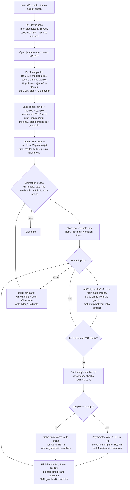

# softrad3.C — what it does, how it flows, and the physics behind it

`softrad3.C` is the second step of the jecsys L3Res chain. It reads the
uniform `rootfiles/jecdata<epoch>.root` written by `reprocess.C` and adds to
it, in place, the **FSR/ISR correction** for every balance measurement
together with its systematic and statistical variations.

It replaces the older `softrad.C`, which extrapolated the response in the
second-jet veto α → 0. `softrad3.C` instead uses the **MPF decomposition**
("HDM", 3-point method): the MPF response is split into the parts carried by
the leading jet, by the other jets, and by unclustered energy, and the
leading-jet response is solved for directly. No α extrapolation is needed,
so the α = 1.00 (no veto) graphs are used for Z+jet and photon+jet.

The worked example is the run

```
root -b -q 'mk_reprocess_RunEpoch.C("2016BCDEF")' > tmp_softrad3.log 2>&1
```

with `mk_reprocess.C` edited so that `reprocess(epoch)` is commented out
and only

```
softrad3(0.0,1.3,true,epoch);   // |eta| < 1.3
softrad3(0.0,2.5,true,epoch);   // |eta| < 2.5 (Z+jet only)
```

run. The log has 55 609 lines; most of it is three-fold repetition of the
same per-bin printout (see §5.1).

---

## 1. Inputs and outputs

**Input** (opened in `UPDATE` mode, so the same file is also the output):

```
rootfiles/jecdata2016BCDEF.root
  <dir>/eta<e1>-<e2>/counts_<sample>_a<xref>    TH1D   (binning template)
  <dir>/eta<e1>-<e2>/mpf1_<sample>_a<xref>      TGraphErrors
  <dir>/eta<e1>-<e2>/mpfn_<sample>_a<xref>      TGraphErrors
  <dir>/eta<e1>-<e2>/mpfu_<sample>_a<xref>      TGraphErrors
  <dir>/eta<e1>-<e2>/mpfchs1_<sample>_a<xref>   TGraphErrors
  <dir>/eta<e1>-<e2>/ptchs_<sample>_a<xref>     TGraphErrors
```

with `dir ∈ {data, mc, ratio}` and `xref = 100` for Z/γ+jet, `30` for
multijet.

**Output**, written with `kOverwrite` (re-running is idempotent):

```
rootfiles/jecdata2016BCDEF.root
  <dir>/eta<e1>-<e2>/hdm_<method>_<sample>               TH1D  HDM-corrected response (R1, or R1_d/R1_m for ratio)
  <dir>/eta<e1>-<e2>/fsr/hkfsr3_<method>_<sample>        TH1D  FSR correction  ΔR = corrected − raw
  <dir>/eta<e1>-<e2>/fsr/hkfsr3_<method>_<sample>_mpf0s  TH1D  stat. error of r0 (data ⊕ MC)
  <dir>/eta<e1>-<e2>/fsr/hkfsr3_<method>_<sample>_mpf1s  TH1D  stat. error of r1
  <dir>/eta<e1>-<e2>/fsr/hkfsr3_<method>_<sample>_mpfn1  TH1D  syst: Rn shifted in data only   (−0.01)
  <dir>/eta<e1>-<e2>/fsr/hkfsr3_<method>_<sample>_mpfn2  TH1D  syst: Rn shifted in data and MC (−0.02)
  <dir>/eta<e1>-<e2>/fsr/hkfsr3_<method>_<sample>_mpfns  TH1D  stat. propagation of rn
  <dir>/eta<e1>-<e2>/fsr/hkfsr3_<method>_<sample>_mpfu1  TH1D  syst: Ru shifted in data only   (+0.08)
  <dir>/eta<e1>-<e2>/fsr/hkfsr3_<method>_<sample>_mpfu2  TH1D  syst: Ru shifted in data and MC (+0.05)
  <dir>/eta<e1>-<e2>/fsr/hkfsr3_<method>_<sample>_mpfus  TH1D  stat. propagation of ru
```

with `method ∈ {mpfchs1, ptchs}`. In this run each `<dir>/eta00-13/` got
180 `hdm_*` histograms and 1620 objects in `fsr/`; each `<dir>/eta00-25/`
got 86 and 774. The file grew from 3.3 MB to 7.5 MB.

`hkfsr3_*` is consumed by `globalFitSyst.C` and `globalFitL3Res.C`;
`hdm_*` by `globalFitSyst.C`, `globalFitRenormPF.C` and `globalFitRun2.C`.

---

## 2. Overall flowchart



Compact text version:

```
softrad3(etamin, etamax, dodijet, epoch)
 1. Flavor init (one-off, informational only in this configuration)
 2. open jecdata<epoch>.root for update
 3. sample list depends on etamax (1.3: everything; 2.5: Z+jet only)
 4. load phase : gs[dir][method][sample], hs[dir][sample]  (asserts on missing objects)
 5. solvers    : fm, fp (Z/γ), fma, fpa (multijet)
 6. for dir in {ratio,data,mc} x method in {mpfchs1,ptchs} x sample:
      for each pT bin of the counts histogram:
         read r0,r1,rn,ru (data) and q0,q1,qn,qu (MC)
         solve R1 (or R_lead/R_recoil) in data and MC, nominal + 4 variations
         fill hdm and hfsr (+8 variation histos)
      write hdm_<method>_<sample> and fsr/hkfsr3_<method>_<sample>[_var]
 7. close
```

---

## 3. Stage-by-stage walkthrough (code view)

Line numbers refer to the current `softrad3.C`.

### 3.1 Global switches and helpers (lines 31–67)

| item | value | meaning |
|---|---|---|
| `useGluonJES` | false (`DP_2021`) | if true, the unclustered response in data would be multiplied by the gluon JES from `Flavor.C`. Off, so the printed `gluonJES(pT=15,|eta|<2.5) = 0.946605` is informational only. |
| `gJESpt` | 15 | reference pT for that gluon JES |
| `getY(pt, ptmin, ptmax, g, ey)` | | returns the y (and error) of the graph point whose x lies inside the histogram bin `[ptmin, ptmax]`; 0 if none. |
| `getEntry(i, …)` | | calls `getY` for four graphs at bin `i` of the template histogram `h`. |

`getY` is meant to pick the point closest to the bin centre, but the
update inside the loop sets `x` instead of `dx`, so `dx` stays 0 and the
first point found inside the bin wins. With one point per bin, as here,
this makes no difference.

### 3.2 Entry, epoch flags, Flavor (lines 73–108)

`softrad3(etamin, etamax, dodijet, epoch)`. The `dodijet` argument is not
used in the body. `isUL16 = isAPV = true` for 2016BCDEF. On the first call
a `Flavor` object is created, which loads the Pythia8 and Herwig7
flavour-dependent L2Relative text files from `rootfiles/flavor/` (the
`Flavor::loadJEC` lines in the log). The second call reuses it.

### 3.3 Sample list (lines 110–254)

| call | samples | count |
|---|---|---|
| `softrad3(0, 1.3)` | `multijet`, `zlljet`, `zeejet`, `zmmjet`, `gamjet`, 6 photon tag sets `gi…gn`, 36 photon tag×gen sets `gii…gnn`, `zjet`, 6 Z tag sets `zi…zn`, 36 Z tag×gen sets `zii…znn` | 90 |
| `softrad3(0, 2.5)` | `zjet`, 6 Z tag sets, 36 Z tag×gen sets | 43 |

Reference α: `aref = 100` for Z/γ+jet (no second-jet veto), `mptref = 30`
for multijet (the a100 multijet graphs do not exist, and the α = 0.30
selection is the multijet standard).

### 3.4 Load phase (lines 256–309)

Three nested loops (`dirs` = data, mc, ratio; `methods` = counts, mpf1,
mpfn, mpfu, mpfchs1, ptchs; `samples`) fetch every object into
`gs[dir][method][sample]` or `hs[dir][sample]`. Tag×gen flavour sets
(`isflavormc`) exist only in MC and are skipped for data and ratio.
The `zlljet` counts histogram does not exist (it was never written by
`reprocess.C`), so the `zmmjet` one is used as a binning template (`PATCH`,
line 293). Any other missing object aborts via `assert`.

### 3.5 Solver functions (lines 311–339)

```
fm : x − ( r0 + (x/Rn − 1)·rn + (x/Ru − 1)·ru ) = 0       MPF,        Z/γ+jet
fp : x − ( r1 + (x/Rn    )·rn + (x/Ru    )·ru ) = 0       pT balance, Z/γ+jet
fma: (x−1)/(x+1) − A + (1 − (x+1)/(2Rn/R2))·Pn + (1 − (x+1)/(2Ru/R2))·Pu = 0   MPF, multijet pT,ave
fpa: (x−1)/(x+1) − B + (0 − (x+1)/(2Rn/R2))·Pn + (0 − (x+1)/(2Ru/R2))·Pu = 0   MJB, multijet pT,ave
```

Parameters `[0..4]` are (r0 or r1, rn, ru, Rn, Ru), plus `[5] = R2` for
multijet. The unknown `x` is solved with `TF1::GetX(0, 0.1, 1.9)` (Brent
root finder on a grid of 100 points). See §4 for the derivation.

### 3.6 Correction phase (lines 342–908)

Loops `dirs2` = ratio, data, mc; `methods2` = mpfchs1, ptchs; samples.
The loop order differs from the load phase so that the ratio is processed
first, but every dir recomputes everything and only stores a different
quantity.

For each (dir, method, sample):

1. **Asserts** (lines 371–381) that the needed graphs exist. For
   `isflavormc` samples the MC graphs are cloned as placeholders for data,
   and the ratio graphs are set to 1 (lines 388–409). That is why the tail
   of the log shows `znn ptchs … R1=1 raw=1` with identical `r` and `q`.
2. **Clone the binning** of the counts histogram into `hdm` and nine
   `hfsr*` histograms, all reset (lines 412–421).
3. **Per bin** `i` (lines 429–879):
   * `getEntry` three times: (`mpf`, `ptbal`) from the ratio graphs,
     (`q0`, `q1`, `qn`, `qu`) from MC, (`r0`, `r1`, `rn`, `ru`) from data.
     `r0` = MPF, `r1` = leading-jet term, `rn` = other-jets term,
     `ru` = unclustered term. Errors `er*`, `eq*` come along.
   * skip the bin if both data and MC are empty (line 437–438).
   * `pt` = mean of the data and MC x positions (line 441) and print
     `<sample> <method> pt=<pt>`.
   * print a warning if `r1+rn+ru ≠ r0` or `q1+qn+qu ≠ q0` beyond 1e-3
     (the decomposition should close exactly; the asserts are commented out).
   * **Set Rn, Ru and their variations** (lines 478–488, `DP_2021` block):

     | constant | value | meaning |
     |---|---|---|
     | `Rn_d = Rn_m` | 1.000 | other jets are fully JEC-corrected in data and MC |
     | `Ru_d = Ru_m` | 0.685 | response of unclustered energy (from DY CP5 UL17 MC) |
     | `R2_d = R2_m` | 1.000 | multijet recoil response |
     | `dRnd` | −0.01 | Rn data-only shift (data/MC guess) |
     | `dRnm` | −0.02 | Rn shift in both (quark/gluon response variation) |
     | `dRud` | +0.08 | Ru data-only shift (QCD data 2.7 vs FullSim 2.5) |
     | `dRum` | +0.05 | Ru shift in both (DY HS1 0.72 vs CP5 0.65) |

     For multijet (lines 490–503) `Ru_d = Ru_m = 0.65` (from
     `minitools/drawMultijetMPB_ISRonly.pdf`), `Rn = 1`, `R2 = 1`.
   * **Multijet** (lines 505–679): convert the stored
     ⟨R_lead⟩/⟨R_recoil⟩ ratios to asymmetries
     `A = (r0−1)/(r0+1)`, `B = (r1−1)/(r1+1)`, and the n/u terms to
     `Pn = rn/(2+rn)`, `Pu = ru/(2+ru)`; solve `fma` (MPF) or `fpa` (MJB)
     for `Rd` and `Rm`; re-solve four times with the shifted Rn/Ru; print
     the `r0= … Ad= … Pnd= … Rd= Rm=` block.
   * **Z/γ+jet MPF** (lines 684–768): solve `fm` for `R1_d`, `R1_m`, then
     the four variations. Check that `r0/q0` agrees with the stored ratio
     `mpf` (assert at 3.9e-3, see §5.4). Print ` MPF pt= R1_d= R1_m= R1= raw=`
     and the two component lines.
   * **Z/γ+jet pT balance** (lines 771–878): same with `fp`, using `r1`
     (the `mpf1` graph) as the leading-jet input. Print `*i= … r1/q1= …` if
     `r1/q1` differs from the stored `ptchs` ratio, then
     ` pTbal pt= R1_d= R1_m= R1= raw=`.
   * **Fill** (lines 573–596, 648–671, 739–762, 849–872):

     | dir | `hdm` content | `hdm` error | `hfsr` content |
     |---|---|---|---|
     | data | `R1_d` | `er0` | `R1_d − r0` (or `− r1`) |
     | mc | `R1_m` | `eq0` | `R1_m − q0` |
     | ratio | `R1_d / R1_m` | `sqrt(er0² + eq0²)` | `R1_d/R1_m − r0/q0` |

     `hfsr` error = `ddR = sqrt(dRn1² + dRn2² + dRu1² + dRu2²)`; the eight
     variation histograms get the individual terms. Guards `if (R1_m>0 ||
     R1_m<0)` skip NaN results so a bin with no MC point stays empty.
4. **Write** (lines 881–897): `mkdir <dir>/eta<e>/fsr` (fails harmlessly
   after the first sample: `Error in <TDirectoryFile::mkdir>: An object with
   name fsr exists already`, 792 times in the log), then the nine
   `hkfsr3_*` and `hdm_*` histograms with `kOverwrite`.

---

## 4. Physics view

### 4.1 The MPF decomposition ("HDM")

In a Z/γ+jet event the Type-I corrected MET balances the reference boson
against everything else. Projecting on the boson axis and dividing by the
reference pT, the MPF response is a sum over the three classes of recoil
objects:

```
R_MPF = r0 = r1 + rn + ru
r1 = R1 · p1      leading jet   (p1 = its particle-level share of the recoil)
rn = Rn · pn      other jets    (pn)
ru = Ru · pu      unclustered   (pu)
p1 + pn + pu = 1  (momentum conservation at particle level)
```

The quantity the global fit needs is **R1**, the response of the leading
jet, which is what the JEC corrects. The measured terms `r1`, `rn`, `ru`
mix the responses with the momentum shares. Writing `pn = rn/Rn`,
`pu = ru/Ru`, `p1 = 1 − pn − pu` and substituting:

```
r0 = R1 (1 − rn/Rn − ru/Ru) + rn + ru
⇒ R1 = r0 + (R1/Rn − 1)·rn + (R1/Ru − 1)·ru          ← solved by fm
```

For the pT balance only the leading-jet term is measured, `r1 = R1·p1`:

```
R1 = r1 + (R1/Rn)·rn + (R1/Ru)·ru                     ← solved by fp
```

So once Rn and Ru are assumed, R1 follows from the measured
`r0` (or `r1`), `rn`, `ru` in each pT bin. Doing this separately in data
and MC gives `R1_d / R1_m`, the FSR/ISR-corrected data/MC ratio that the
L3Res fit uses, and

```
k_FSR = hkfsr3 = R1_d / R1_m − r0 / q0
```

is the additive correction with respect to the raw ratio. No α cut and no
extrapolation are needed, which is why `softrad3.C` reads the α = 1.00
graphs.

### 4.2 Assumptions, and how they become systematics

* **Rn = 1**: additional jets above threshold are already corrected to the
  particle level by the full JEC in both data and MC. A data/MC difference
  of −1 % (`dRnd`) and a common −2 % (`dRnm`, quark/gluon response) are
  propagated into `hkfsr3_*_mpfn1` and `_mpfn2`.
* **Ru = 0.685**: unclustered energy is soft, mostly charged hadrons and
  photons below the jet threshold, and responds much lower than 1. The
  value comes from DY MC with the CP5 tune. A data-only +0.08 (`dRud`) and
  a common +0.05 (`dRum`) are propagated into `_mpfu1` and `_mpfu2`.
* The `_mpf0s`, `_mpf1s`, `_mpfns`, `_mpfus` histograms carry the
  statistical uncertainties of the inputs for the fit's error model.
* `_mpfn1`/`_mpfu1` are "data/MC difference" type nuisances; `_mpfn2`/
  `_mpfu2` are "MC reference scale" type nuisances. `globalFitSyst.C`
  turns these into eigenvectors for `globalFitL3Res.C`.

Because `ru` is sizeable only at low pT (0.16 at 17.5 GeV, 0.07 at 50 GeV
for Zll+jet), the Ru uncertainty is the dominant FSR systematic at low pT
and vanishes above a few hundred GeV; this is visible in the `u1` column
of the tables in §5.5.

### 4.3 Multijet in pT,ave binning

For multijet the stored MPF and MJB are ratios ⟨R_lead⟩/⟨R_recoil⟩ in
bins of pT,ave = (pT,lead + pT,recoil)/2. The code first converts them to
asymmetries `A = (r0−1)/(r0+1)` and the n/u terms to `Pn = rn/(2+rn)`,
`Pu = ru/(2+ru)`, then solves the asymmetry analogue of the master
equation (`fma`, `fpa`) for `x = R_lead/R_recoil` with `R2 = 1` for the
recoil, `Rn = 1` and `Ru = 0.65`. The procedure for data, MC and the
four variations is the same as for Z/γ+jet. The recoil-scale correction
(`f1mjb`) was already applied in `reprocess.C`.

### 4.4 What "ptchs" means here

For the pT-balance slot the leading-jet input `r1` is the **`mpf1`
graph** (leading-jet MPF term), not the stored `ptchs` graph. For Zll+jet
the two coincide because `reprocess.C` stores `MPF-leading-jet_CHS` as
`ptchs`; for photon+jet the stored `ptchs` is the genuine pT balance
(`resp_PtBalchs`), so `raw` and `r1/q1` differ (`*i=6 pt=45 r1/q1=1.00046
mpf=0.986343` vs `raw=1.00423`). Consequently `hdm_ptchs_*` is numerically
almost identical to `hdm_mpfchs1_*`, and `hkfsr3_ptchs_*` =
`R1_d/R1_m − r1/q1` is the correction that brings the pT balance (as the
global fit reads it) onto the HDM leading-jet response.

---

## 5. Worked example: reading `tmp_softrad3.log` for 2016BCDEF

### 5.1 Structure

```
Calling softrad3(0,1.3,1);              first call, |η| < 1.3
For epoch 2016BCDEF
Initializing Flavor                     one-off
Flavor::loadJEC("Pythia8")...  (+6 files)
Flavor::loadJEC("Herwig7")...  (+6 files)
gluonJES(pT=15,|eta|<2.5) = 0.946605    informational (useGluonJES = false)
multijet mpfchs1 pt=133.5               dir = ratio, method = mpfchs1, first multijet bin
r0=0.97237 r1=0.983937 q0=0.979851 q1=0.989599
Ad=-0.0140085 Bd=-0.0080965 Am=-0.0101771 Bm=-0.00522775
Pnd=-4.86017e-07 Pud=-0.00585561 Pnm=0.000927414 Pum=-0.00604233
Rd=0.966547 Rm=0.973709
...  (17 multijet bins)
zlljet mpfchs1 pt=17.5                  next sample
zlljet: r0/q0=1.01547 mpf=1.01654 diff=0.00107381
 MPF pt=17.5 R1_d=1.2852 R1_m=1.25084 R1=1.02747 raw=1.01654
  - r0=1.14252 r1=0.982453 rn=-0.00428687 ru=0.164234
  - q0=1.12512 q1=0.978339 qn=-0.00762345 qu=0.154512
...
Error in <TDirectoryFile::mkdir>: An object with name fsr exists already   (after each sample)
zeejet mpfchs1 pt=17.5
...
multijet ptchs pt=133.5                 method = ptchs starts (still dir = ratio)
...
(the whole block repeats for dir = data and dir = mc with identical numbers)
Calling softrad3(0,2.5,1);              second call, |η| < 2.5, Z+jet samples only
...
```

Sample order within each (dir, method) block: multijet, zlljet, zeejet,
zmmjet, gamjet, 42 photon flavour sets, zjet, 42 Z flavour sets. The log
printed 7458 bin blocks in the first call and 3648 in the second. Since the
three dirs print the same numbers, each physical bin appears three times.

### 5.2 Decoding a Z+jet MPF block

```
zlljet mpfchs1 pt=17.5
zlljet: r0/q0=1.01547 mpf=1.01654 diff=0.00107381
 MPF pt=17.5 R1_d=1.2852 R1_m=1.25084 R1=1.02747 raw=1.01654
  - r0=1.14252 r1=0.982453 rn=-0.00428687 ru=0.164234
  - q0=1.12512 q1=0.978339 qn=-0.00762345 qu=0.154512
```

| field | meaning |
|---|---|
| `pt=17.5` | mean of data and MC x positions in bin 1 of `counts_zmmjet_a100` |
| `r0 … ru` | data: MPF = 1.1425, leading jet 0.9825, other jets −0.0043, unclustered 0.1642 (sum 1.1425 ✓) |
| `q0 … qu` | same in MC |
| `r0/q0=1.01547 mpf=1.01654 diff=0.00107` | the stored ratio graph (built in `reprocess.C` by merging the Zee and Zμμ ratios) differs from data/MC of the merged data and MC graphs by 0.1 %; tolerated up to 0.39 % |
| `R1_d=1.2852` | solution of `fm` in data: the leading jet alone responds 1.285 relative to the Z at 17.5 GeV once the low-response unclustered share is unfolded |
| `R1_m=1.25084` | same in MC |
| `R1=1.02747` | corrected data/MC ratio → `hdm_mpfchs1_zlljet` bin 1 |
| `raw=1.01654` | uncorrected ratio; `hkfsr3_mpfchs1_zlljet` bin 1 = 1.02747 − 1.01654 = +0.0109 (file value +0.0120 uses `r0/q0` instead of the stored `mpf`) |

At 17.5 GeV the unclustered term is 16 % of the MPF; with Ru = 0.685 it
carries a 24 % momentum share, which is why R1 comes out so far above r0.

### 5.3 Decoding a multijet block

```
multijet mpfchs1 pt=133.5
r0=0.97237 r1=0.983937 q0=0.979851 q1=0.989599
Ad=-0.0140085 Bd=-0.0080965 Am=-0.0101771 Bm=-0.00522775
Pnd=-4.86017e-07 Pud=-0.00585561 Pnm=0.000927414 Pum=-0.00604233
Rd=0.966547 Rm=0.973709
```

`r0` (MPF) and `r1` (MJB) are ⟨R_lead⟩/⟨R_recoil⟩ in data, `q0`, `q1` in
MC; `A`, `B` are the asymmetries; `Pn`, `Pu` the other-jet and
unclustered asymmetry terms; `Rd`, `Rm` the solved leading/recoil ratios.
For dir = ratio, `hdm_mpfchs1_multijet` bin = Rd/Rm = 0.9926 and
`hkfsr3` = Rd/Rm − r0/q0 = +0.0003. The `multijet ptchs` block for the
same bin reuses the same inputs and solves `fpa` with `B`.

### 5.4 The warnings and errors in the log

| log text | count | cause | consequence |
|---|---|---|---|
| `i=.. pt=.. r1+rn+ru-r0=..` / `q1+qn+qu-q0=..` | 1020 / 960 | decomposition does not close to 1e-3; mostly flavour MC sets with sparse bins, and Zll+jet at pT = 850 where only data has a point (−0.0016); worst cases −0.02 and +0.92 in tag×gen sets with junk bins | none, asserts are commented out |
| `zlljet: r0/q0=.. mpf=.. diff=..` | few | merged ratio ≠ ratio of merged graphs | assert passes (< 3.9e-3) |
| `*i=.. r1/q1=.. mpf=..` | 339 | `mpf1` ratio ≠ stored `ptchs` ratio (expected for photon+jet, see §4.4, and for Zll+jet merging) | none |
| `Error in <TF1::GetX>: [0.1,1.9] is not a valid interval` (+ 3 `BrentMethods`/`BrentRootFinder` lines each) | 1380 | a solve was attempted with all-zero inputs (one side missing). Attribution for |η|<1.3: `zlljet`/`zeejet` 9 each (pT = 850 GeV data-only point: 3 MC solves × 3 dirs), `zbq` 6, the rest in tag×gen MC sets `gn`, `gin`, `gnc`, `gng`, `gnn`, `gqn`, `gc`, `zn`, `znb`, `zcn`, `zgn`, `zin`, `znn`, `zqn`, `zbn` | the result is NaN and the NaN guards leave the bin empty in `hdm`/`hfsr`; the physics samples are unaffected except for that 850 GeV bin |
| ` MPF pt=850 R1_d=1.00154 R1_m=nan R1=nan raw=0` | 3 | same event for zlljet | bin 19 of `hdm_mpfchs1_zlljet` stays empty (graph has 18 points, data 19) |
| `Error in <TDirectoryFile::mkdir>: An object with name fsr exists already` | 792 | `mkdir` called for every sample, succeeds only for the first in each (dir, η) | harmless |

### 5.5 What ended up in the file

`ratio/eta00-13/hdm_mpfchs1_zlljet` and the corresponding `fsr/hkfsr3_*`
(HDM-corrected data/MC ratio, FSR correction, and the four systematic
shifts):

| pT (GeV) | hdm = R1_d/R1_m | k_FSR | n1 (Rn data −0.01) | n2 (Rn both −0.02) | u1 (Ru data +0.08) | u2 (Ru both +0.05) |
|---|---|---|---|---|---|---|
| 17.5 | 1.0275 ± 0.0053 | +0.0120 ± 0.0327 | −0.0001 | +0.0001 | −0.0326 | −0.0017 |
| 27.5 | 1.0038 ± 0.0035 | +0.0034 ± 0.0167 | −0.0000 | +0.0001 | −0.0166 | −0.0006 |
| 47.5 | 0.9972 ± 0.0032 | +0.0008 ± 0.0127 | +0.0002 | −0.0000 | −0.0127 | −0.0003 |
| 95 | 1.0013 ± 0.0020 | +0.0033 ± 0.0078 | +0.0007 | +0.0002 | −0.0077 | −0.0007 |
| 202.5 | 1.0002 ± 0.0023 | +0.0019 ± 0.0044 | +0.0009 | +0.0002 | −0.0042 | −0.0004 |
| 450 | 0.9919 ± 0.0063 | −0.0001 ± 0.0016 | +0.0010 | +0.0002 | −0.0012 | −0.0001 |
| 600 | 0.9945 ± 0.0097 | −0.0030 ± 0.0011 | +0.0010 | −0.0002 | +0.0002 | +0.0006 |

The FSR correction for Zll+jet MPF is at the per-mille level above 30 GeV
and +1.2 % in the first bin; its uncertainty is dominated by the Ru
data-only shift (u1), 3.3 % at 17.5 GeV falling to 0.1 % at 450 GeV.

Photon+jet (`hdm_mpfchs1_gamjet`): the correction is −0.7 % at 45 GeV,
−0.2 % at 100–200 GeV, −0.5 % at 1100 GeV, with u1 from −2.0 % to −0.1 %.
For the photon+jet pT balance the correction is larger (−2.1 % at 45 GeV,
−1 % at 200 GeV, −2.9 % at 925–1100 GeV) because the raw pT balance is a
different observable from `mpf1` (§4.4).

Multijet (`hdm_mpfchs1_multijet`): corrections are below 0.1 % at all
pT, uncertainties 0.2 % at 130 GeV falling to 0.05 % at 2 TeV, since the
n and u terms are tiny in the pT,ave asymmetry form.

Data and MC directories hold the individual `R1_d` and `R1_m`, e.g.
`data/eta00-13/hdm_mpfchs1_zlljet` = 1.2852, 1.1747, 1.1243, 1.0954,
1.0807, 1.0719 for the first six bins and
`mc/eta00-13/hdm_mpfchs1_zlljet` = 1.2508, 1.1806, 1.1200, 1.0993,
1.0941, 1.0821.

---

## 6. Practical notes and quirks

* The file is opened in `UPDATE` mode; a crash mid-way does not truncate
  it, unlike `reprocess.C`, but outputs are overwritten with `kOverwrite`
  only when a sample completes.
* `hruncl` from `reprocess.C` is **not** read here: this `DP_2021` version
  uses the hard-coded `Ru = 0.685` (0.65 for multijet). The `useGluonJES`
  switch, which would scale Ru by the gluon JES from `Flavor.C`, is off.
* The `dodijet` argument is unused; `samples` are selected purely by
  `etamax` and epoch.
* The missing `counts_zlljet_a100` is patched with the `zmmjet` one for
  binning. The `zlljet` ratio check tolerance was loosened to 3.9e-3 for
  Run2Test and applies to all epochs.
* `hdm` errors in the ratio directory are `sqrt(er0² + eq0²)` with
  absolute errors; the code comments say the statistical treatment "will
  need more careful handling".
* `if (dR_m>0 | dR_m<0)` (line 860) uses a bitwise OR; the result is the
  same as the logical OR here.
* For tag×gen flavour MC samples, "data" and "ratio" outputs are
  placeholders (MC copied, ratio set to 1), so `hkfsr3_*` for those in
  `data/` and `ratio/` have no physical meaning.
* Error lines from `TF1::GetX` are expected whenever one of data/MC has no
  point in a bin; they only matter if they appear for `zlljet`, `zeejet`,
  `zmmjet`, `gamjet`, `zjet` or `multijet` at a pT inside the fit range.
